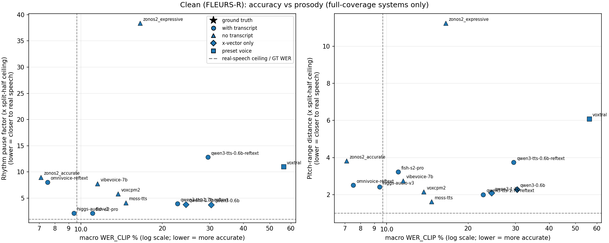
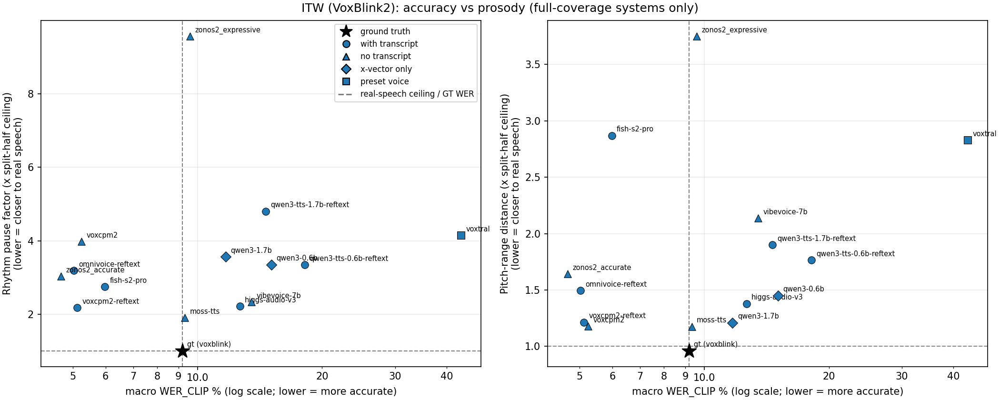
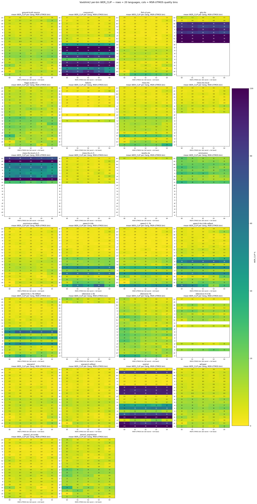
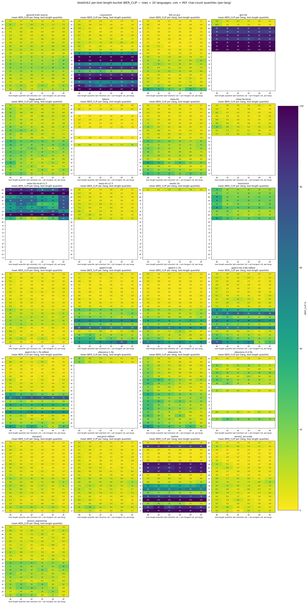
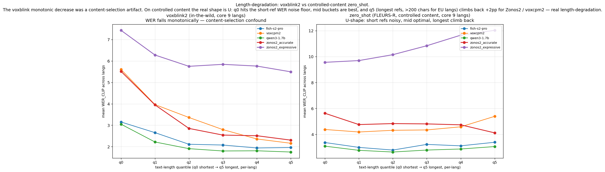

# ZTTS2-Eval — Current Results Snapshot

Benchmark version 2

Regenerated from the `results/` directory tree by
`scripts/results_doc/run.sh`. Numbers are read directly from
`wav_res_ref_text.wer`, `spk_simi_scores.txt`, `spk_simi_scores.xutt.txt` (ITW),
`msr_utmos_mean.txt` and the rhythm / pitch-range / paired-ITW CSVs. **WER_CLIP**
(per-utt WER capped at 100% before averaging) is the robust mean; raw WER, WER_L50
and the tail rate (share of utterances above 50% WER) are also tracked. Speaker
similarity is cosine × 100 (ReDimNet); MSR-UTMOS is the MOS predictor.

> Scores are not comparable with ZTTS1-Eval.

What the scores in this document reflect:

- per-language ASR routing, enforced: `fa`, `hi`, `ko`, `th`, `vi`, `zh` on `Qwen/Qwen3-ASR-1.7B@7278e1e`, every other language on `openai/whisper-large-v3@06f233f`; a leaf scored with any other ASR is refused by the build;
- digits expanded to words on both reference and hypothesis before WER;
- prompt/target near-duplicates removed (Clean 22 removed, 57,388 → 57,366; ITW 164 removed, 17,319 → 17,155; list in `data/near_duplicates_removed.json`);
- all 20 ITW languages in the aggregates, including `tl`;
- ITW speaker similarity against a held-out recording of the same speaker (prompt similarity kept as a secondary column);
- pitch measured as a register-normalized pitch-range distance.

## 0. Headline

Macro = unweighted mean over the set's language basket (35 Clean, 20 ITW); a system is ranked only when it covers every language of the basket. Within a class tables are sorted by name, not by score: pick the axis you care about. **×ceil** columns are distances divided by the real-speech split-half ceiling (1.0 = indistinguishable from real speech, lower is better). The figure shows accuracy (x) against rhythm pause factor (left) and pitch-range distance (right); bottom-left is best.

### Clean (FLEURS-R)

**Real-speech reference**

| System | WER_CLIP | Tail >50% | SPK (prompt) | MSR-UTMOS | Rhythm pace ×ceil | Rhythm pause ×ceil | Pitch range ×ceil | MPM span (Clean only) |
|---|--:|--:|--:|--:|--:|--:|--:|--:|
| gt (fleurs-r) | 9.66 | 1.4 | — | 3.28 | — | — | — | -0.01 |

**with-transcript clones**

| System | WER_CLIP | Tail >50% | SPK (prompt) | MSR-UTMOS | Rhythm pace ×ceil | Rhythm pause ×ceil | Pitch range ×ceil | MPM span (Clean only) |
|---|--:|--:|--:|--:|--:|--:|--:|--:|
| fish-s2-pro | 11.03 | 3.0 | 81.2 | 3.16 | 2.18 | 2.13 | 3.22 | 0.79 |
| higgs-audio-v3 | 9.42 | 1.3 | 79.5 | 2.99 | 2.55 | 2.15 | 2.42 | 0.33 |
| omnivoice-reftext | 7.52 | 1.2 | 87.6 | 3.05 | 9.14 | 8.05 | 2.51 | 0.52 |
| qwen3-tts-0.6b-reftext | 29.56 | 22.1 | 79.8 | 3.20 | 5.03 | 12.83 | 3.74 | 0.24 |
| qwen3-tts-1.7b-reftext | 22.80 | 13.5 | 80.6 | 3.16 | 5.85 | 3.93 | 2.00 | 0.46 |

**no-transcript clones †**

| System | WER_CLIP | Tail >50% | SPK (prompt) | MSR-UTMOS | Rhythm pace ×ceil | Rhythm pause ×ceil | Pitch range ×ceil | MPM span (Clean only) |
|---|--:|--:|--:|--:|--:|--:|--:|--:|
| moss-tts† | 14.66 | 5.4 | 83.6 | 3.07 | 3.28 | 4.13 | 1.62 | 0.60 |
| vibevoice-7b† | 11.50 | 2.9 | 82.2 | 3.14 | 4.11 | 7.76 | 2.75 | 0.21 |
| voxcpm2† | 13.72 | 6.1 | 78.9 | 2.93 | 9.10 | 5.82 | 2.15 | 0.52 |
| zonos2_accurate† | 7.10 | 1.0 | 75.0 | 3.11 | 5.86 | 9.00 | 3.82 | 0.56 |
| zonos2_expressive† | 16.55 | 10.1 | 66.7 | 2.97 | 27.90 | 38.38 | 11.24 | 0.45 |

**x-vector-only clones ◇**

| System | WER_CLIP | Tail >50% | SPK (prompt) | MSR-UTMOS | Rhythm pace ×ceil | Rhythm pause ×ceil | Pitch range ×ceil | MPM span (Clean only) |
|---|--:|--:|--:|--:|--:|--:|--:|--:|
| qwen3-0.6b◇ | 30.39 | 24.3 | 69.2 | 3.55 | 5.09 | 3.74 | 2.28 | 0.39 |
| qwen3-1.7b◇ | 24.46 | 15.8 | 69.6 | 3.54 | 5.40 | 3.80 | 2.09 | 0.47 |

**preset voices ‡ (not cloning the prompt)**

| System | WER_CLIP | Tail >50% | SPK (prompt) | MSR-UTMOS | Rhythm pace ×ceil | Rhythm pause ×ceil | Pitch range ×ceil | MPM span (Clean only) |
|---|--:|--:|--:|--:|--:|--:|--:|--:|
| voxtral‡ | 56.38 | 56.3 | 16.9 | 3.34 | 18.58 | 11.01 | 6.09 | 0.61 |

**Partial coverage — not comparable**

Missing WER for at least one basket language; no macro value is shown.

| System | Langs with WER | Missing |
|---|--:|---|
| cosyvoice3 | 29/35 | `ar`, `hi`, `th`, `vi`, `he`, `fa` |
| glm-tts | 21/35 | 14 languages |
| kokoro‡ | 8/35 | 27 languages |
| moss-tts-local† | 9/35 | 26 languages |
| moss-tts-local-v1.5† | 9/35 | 26 languages |
| moss-tts-v1.5† | 9/35 | 26 languages |
| neutts-2e‡ | 1/35 | 34 languages |
| omnivoice† | 9/35 | 26 languages |
| vibevoice-1.5b† | 2/35 | 33 languages |
| vibevoice-rt-0.5b‡ | 10/35 | 25 languages |
| voxcpm2-reftext | 33/35 | `hi`, `th` |

† = no-transcript clone (audio-only) · ◇ = x-vector-only clone · ‡ = preset voice (not cloning the prompt) · unmarked = ref transcript given. See §1b.

### ITW (VoxBlink2, in the wild)

Speaker similarity is scored against a held-out recording of the same speaker (**SPK held-out**); **SPK prompt** is similarity to the prompt, and the **copy gap** is their difference — a large gap means the system reproduces the prompt's channel rather than the speaker. **Dur**, **Pause Δ** and **Pitch-range |log2|** are per-utterance paired medians against the real recording (lower is better).

**Real-speech reference**

| System | WER_CLIP | Tail >50% | SPK held-out | SPK prompt | Copy gap (prompt − held-out) | MSR-UTMOS | Rhythm pace ×ceil | Rhythm pause ×ceil | Pitch range ×ceil | Dur \|log2\| | Pause Δ | Pitch-range \|log2\| |
|---|--:|--:|--:|--:|--:|--:|--:|--:|--:|--:|--:|--:|
| gt (voxblink) | 9.19 | 0.9 | 79.3 | 79.3 | 0.0 | 2.25 | 1.10 | 1.00 | 0.96 | — | — | — |

**with-transcript clones**

| System | WER_CLIP | Tail >50% | SPK held-out | SPK prompt | Copy gap (prompt − held-out) | MSR-UTMOS | Rhythm pace ×ceil | Rhythm pause ×ceil | Pitch range ×ceil | Dur \|log2\| | Pause Δ | Pitch-range \|log2\| |
|---|--:|--:|--:|--:|--:|--:|--:|--:|--:|--:|--:|--:|
| fish-s2-pro | 5.98 | 1.5 | 61.7 | 70.3 | 8.6 | 2.64 | 2.01 | 2.75 | 2.87 | 0.19 | 0.47 | 0.52 |
| higgs-audio-v3 | 12.66 | 3.6 | 62.4 | 69.2 | 6.9 | 2.34 | 1.85 | 2.22 | 1.38 | 0.20 | 0.45 | 0.44 |
| omnivoice-reftext | 5.03 | 1.0 | 65.0 | 75.0 | 10.0 | 2.82 | 4.46 | 3.19 | 1.50 | 0.22 | 0.76 | 0.45 |
| qwen3-tts-0.6b-reftext | 18.14 | 12.1 | 63.7 | 73.3 | 9.6 | 2.65 | 2.91 | 3.34 | 1.77 | 0.27 | 2.66 | 0.46 |
| qwen3-tts-1.7b-reftext | 14.61 | 8.8 | 65.0 | 74.5 | 9.5 | 2.66 | 4.59 | 4.80 | 1.90 | 0.31 | 0.62 | 0.44 |
| voxcpm2-reftext | 5.12 | 0.6 | 67.5 | 77.8 | 10.3 | 2.27 | 1.65 | 2.17 | 1.22 | 0.20 | 0.43 | 0.49 |

**no-transcript clones †**

| System | WER_CLIP | Tail >50% | SPK held-out | SPK prompt | Copy gap (prompt − held-out) | MSR-UTMOS | Rhythm pace ×ceil | Rhythm pause ×ceil | Pitch range ×ceil | Dur \|log2\| | Pause Δ | Pitch-range \|log2\| |
|---|--:|--:|--:|--:|--:|--:|--:|--:|--:|--:|--:|--:|
| moss-tts† | 9.33 | 2.6 | 63.7 | 72.9 | 9.2 | 2.54 | 2.64 | 1.91 | 1.18 | 0.22 | 0.58 | 0.46 |
| vibevoice-7b† | 13.51 | 6.5 | 58.1 | 65.2 | 7.2 | 2.43 | 2.85 | 2.33 | 2.14 | 0.25 | 0.52 | 0.50 |
| voxcpm2† | 5.25 | 0.7 | 64.2 | 73.9 | 9.7 | 2.31 | 4.11 | 3.98 | 1.18 | 0.23 | 0.35 | 0.48 |
| zonos2_accurate† | 4.68 | 0.9 | 52.6 | 57.8 | 5.3 | 2.79 | 2.61 | 3.03 | 1.64 | 0.22 | 1.07 | 0.47 |
| zonos2_expressive† | 9.59 | 4.5 | 51.4 | 57.0 | 5.6 | 2.46 | 7.73 | 9.57 | 3.75 | 0.26 | 1.33 | 0.61 |

**x-vector-only clones ◇**

| System | WER_CLIP | Tail >50% | SPK held-out | SPK prompt | Copy gap (prompt − held-out) | MSR-UTMOS | Rhythm pace ×ceil | Rhythm pause ×ceil | Pitch range ×ceil | Dur \|log2\| | Pause Δ | Pitch-range \|log2\| |
|---|--:|--:|--:|--:|--:|--:|--:|--:|--:|--:|--:|--:|
| qwen3-0.6b◇ | 15.07 | 9.8 | 55.9 | 64.3 | 8.3 | 2.85 | 3.18 | 3.35 | 1.45 | 0.25 | 0.76 | 0.45 |
| qwen3-1.7b◇ | 11.71 | 6.7 | 58.1 | 67.1 | 9.0 | 2.84 | 3.41 | 3.56 | 1.21 | 0.26 | 0.56 | 0.46 |

**preset voices ‡ (not cloning the prompt)**

| System | WER_CLIP | Tail >50% | SPK held-out | SPK prompt | Copy gap (prompt − held-out) | MSR-UTMOS | Rhythm pace ×ceil | Rhythm pause ×ceil | Pitch range ×ceil | Dur \|log2\| | Pause Δ | Pitch-range \|log2\| |
|---|--:|--:|--:|--:|--:|--:|--:|--:|--:|--:|--:|--:|
| voxtral‡ | 43.29 | 43.1 | 13.9 | 13.8 | -0.1 | 3.38 | 6.98 | 4.15 | 2.83 | 0.65 | 3.06 | 0.68 |

**Partial coverage — not comparable**

Missing WER for at least one basket language; no macro value is shown.

| System | Langs with WER | Missing |
|---|--:|---|
| cosyvoice3 | 17/20 | `ko`, `ar`, `th` |
| glm-tts | 9/20 | `pt`, `ar`, `hi`, `id`, `tr`, `tl`, `pl`, `th`, `nl`, `uk`, `vi` |
| kokoro‡ | 8/20 | `de`, `ko`, `ru`, `ar`, `id`, `tr`, `tl`, `pl`, `th`, `nl`, `uk`, `vi` |
| moss-tts-local† | 9/20 | `pt`, `ar`, `hi`, `id`, `tr`, `tl`, `pl`, `th`, `nl`, `uk`, `vi` |
| moss-tts-local-v1.5† | 9/20 | `pt`, `ar`, `hi`, `id`, `tr`, `tl`, `pl`, `th`, `nl`, `uk`, `vi` |
| moss-tts-v1.5† | 9/20 | `pt`, `ar`, `hi`, `id`, `tr`, `tl`, `pl`, `th`, `nl`, `uk`, `vi` |
| neutts-2e‡ | 1/20 | 19 languages |
| omnivoice† | 9/20 | `pt`, `ar`, `hi`, `id`, `tr`, `tl`, `pl`, `th`, `nl`, `uk`, `vi` |
| vibevoice-1.5b† | 2/20 | 18 languages |
| vibevoice-rt-0.5b‡ | 10/20 | `zh`, `ru`, `ar`, `hi`, `id`, `tr`, `tl`, `th`, `uk`, `vi` |

† = no-transcript clone (audio-only) · ◇ = x-vector-only clone · ‡ = preset voice (not cloning the prompt) · unmarked = ref transcript given. See §1b.

MPM span is reported for the Clean set only: its anchors collapse on in-the-wild audio (`docs/mpm_itw_limits.md`).

## 1. Coverage matrix

| Model | zero_shot | voxblink |
|---|:-:|:-:|
| `fish-s2-pro` | ✓ | ✓ |
| `glm-tts` | ✓ | ✓ |
| `higgs-audio-v3` | ✓ | ✓ |
| `omnivoice` | ✓ | ✓ |
| `omnivoice-reftext` | ✓ | ✓ |
| `qwen3-0.6b` | ✓ | ✓ |
| `qwen3-1.7b` | ✓ | ✓ |
| `qwen3-tts-0.6b-reftext` | ✓ | ✓ |
| `qwen3-tts-1.7b-reftext` | ✓ | ✓ |
| `voxcpm2` | ✓ | ✓ |
| `voxcpm2-reftext` | ✓ | ✓ |
| `voxtral` | ✓ | ✓ |
| `cosyvoice3` | ✓ | ✓ |
| `kokoro` | ✓ | ✓ |
| `moss-tts` | ✓ | ✓ |
| `moss-tts-local` | ✓ | ✓ |
| `moss-tts-local-v1.5` | ✓ | ✓ |
| `moss-tts-v1.5` | ✓ | ✓ |
| `neutts-2e` | ✓ | ✓ |
| `vibevoice-1.5b` | ✓ | ✓ |
| `vibevoice-7b` | ✓ | ✓ |
| `vibevoice-rt-0.5b` | ✓ | ✓ |
| `zonos2_accurate` | ✓ | ✓ |
| `zonos2_expressive` | ✓ | ✓ |
| `gt (fleurs-r)` | ✓ | — |
| `gt (voxblink)` | — | ✓ |

## 1b. Conditioning

The systems below are NOT all run under the same conditioning — what each one
is given alongside the target text is a harness policy that differs per
system (see `scripts/results_doc/rd_common.py:CONDITIONS` for the code
provenance). WER is strongly sensitive to it: `omnivoice` scores 34.2 avg WER
without the reference transcript vs 3.2 with it, on the same weights. Rows in
the ranking tables carry the class markers († ◇ ‡) so classes are never
compared undisclosed.

| Model | ref transcript? | cloning class | sampling/config |
|---|:-:|---|---|
| `fish-s2-pro` | yes | with-transcript clone | ref_text kept (server rejects no-ref-text); unseeded server defaults |
| `glm-tts` | yes | with-transcript clone | ref_text kept (default policy, no-ref-text unverified); unseeded server defaults |
| `higgs-audio-v3` | yes | with-transcript clone | ref_text kept (upstream prescribes ref_audio + ref_text); unseeded server defaults |
| `omnivoice†` | no | no-transcript clone † | --no-ref-text (reftext_policy); unseeded server defaults |
| `omnivoice-reftext` | yes | with-transcript clone | same weights as omnivoice, ref_text kept (separate key); unseeded server defaults |
| `qwen3-0.6b◇` | no | x-vector-only clone ◇ | --no-ref-text --x-vector-only → x_vector_only_mode=True; unseeded server defaults |
| `qwen3-1.7b◇` | no | x-vector-only clone ◇ | --no-ref-text --x-vector-only → x_vector_only_mode=True; unseeded server defaults |
| `qwen3-tts-0.6b-reftext` | yes | with-transcript clone | same weights as qwen3-tts-0.6b, ref_text kept (separate key); unseeded server defaults |
| `qwen3-tts-1.7b-reftext` | yes | with-transcript clone | same weights as qwen3-tts-1.7b, ref_text kept (separate key); unseeded server defaults |
| `voxcpm2†` | no | no-transcript clone † | --no-ref-text (reftext_policy); unseeded server defaults |
| `voxcpm2-reftext` | yes | with-transcript clone | same weights as voxcpm2, ref_text kept (separate key); unseeded server defaults |
| `voxtral‡` | n/a | preset voice ‡ | preset mode (task_type=CustomVoice); unseeded server defaults |
| `cosyvoice3` | yes | with-transcript clone | native upstream; prompt wav + transcript (endofprompt-terminated system prompt; ja→katakana) |
| `kokoro‡` | n/a | preset voice ‡ | built-in voice per language; prompt wav ignored |
| `moss-tts†` | no | no-transcript clone † | audio-only clone (generate_moss_tts.py, no transcript); temp 0.9 reference-app sampling |
| `moss-tts-local†` | no | no-transcript clone † | audio-only clone (generate_moss_tts.py, no transcript); temp 0.9 reference-app sampling |
| `moss-tts-local-v1.5†` | no | no-transcript clone † | audio-only clone (generate_moss_tts.py, no transcript); temp 0.9 reference-app sampling |
| `moss-tts-v1.5†` | no | no-transcript clone † | audio-only clone (generate_moss_tts.py, no transcript); temp 0.9 reference-app sampling |
| `neutts-2e‡` | n/a | preset voice ‡ | 4 fixed speakers, deterministic per-utt rotation; prompt wav ignored |
| `vibevoice-1.5b†` | no | no-transcript clone † | voice-prompt clone (voice_samples=[ref wav], no transcript); cfg 1.3, 10 DDPM steps |
| `vibevoice-7b†` | no | no-transcript clone † | voice-prompt clone (voice_samples=[ref wav], no transcript); cfg 1.3, 10 DDPM steps |
| `vibevoice-rt-0.5b‡` | n/a | preset voice ‡ | preset speaker embeddings, per-utt rotation; prompt wav ignored |
| `zonos2_accurate†` | no | no-transcript clone † | audio-only clone; accurate_mode=true; seed 0, temp 1.15 vendor sampling |
| `zonos2_expressive†` | no | no-transcript clone † | audio-only clone; accurate_mode=false; seed 0, temp 1.15 vendor sampling |

Seeding: `zonos2_*` runs are fixed-seed (0); vLLM-Omni-served systems pass no
seed or temperature (unseeded server-default sampling); native recipes note
their sampling defaults above.

## 2. Zero-shot WER_CLIP % (35 languages)

| Lang | fish-s2-pro | glm-tts | higgs-audio-v3 | omnivoice† | omnivoice-reftext | qwen3-0.6b◇ | qwen3-1.7b◇ | qwen3-tts-0.6b-reftext | qwen3-tts-1.7b-reftext | voxcpm2† | voxcpm2-reftext | voxtral‡ | cosyvoice3 | kokoro‡ | moss-tts† | moss-tts-local† | moss-tts-local-v1.5† | moss-tts-v1.5† | neutts-2e‡ | vibevoice-1.5b† | vibevoice-7b† | vibevoice-rt-0.5b‡ | zonos2_accurate† | zonos2_expressive† | gt (fleurs-r) |
|---|--:|--:|--:|--:|--:|--:|--:|--:|--:|--:|--:|--:|--:|--:|--:|--:|--:|--:|--:|--:|--:|--:|--:|--:|--:|
| en | 2.14 | 4.54 | 3.56 | 28.30 | 2.60 | 2.20 | 1.89 | 3.38 | 2.37 | 3.59 | 3.93 | 2.64 | 3.14 | 2.10 | 2.59 | 2.62 | 25.06 | 2.83 | 11.96 | 3.87 | 2.81 | 2.91 | 2.45 | 4.33 | 4.30 |
| zh | 4.02 | 4.23 | 6.29 | 33.05 | 3.34 | 3.48 | 3.07 | 5.19 | 4.64 | 5.06 | 4.63 | 91.49 | 3.35 | 4.65 | 3.72 | 3.75 | 99.67 | 3.89 | — | 4.72 | 3.68 | — | 11.82 | 16.25 | 3.02 |
| de | 3.10 | 87.63 | 5.20 | 38.33 | 3.40 | 3.18 | 2.66 | 4.71 | 3.17 | 4.50 | 4.06 | 3.40 | 8.75 | — | 4.05 | 4.84 | 19.68 | 4.17 | — | — | 5.81 | 13.21 | 3.75 | 11.96 | 4.64 |
| es | 1.99 | 73.33 | 3.18 | 40.95 | 2.13 | 2.17 | 1.77 | 3.15 | 2.26 | 3.70 | 3.21 | 2.00 | 4.15 | 1.96 | 2.52 | 2.56 | 28.63 | 2.52 | — | — | 3.02 | 4.20 | 2.09 | 7.65 | 2.89 |
| fr | 3.03 | 87.00 | 4.74 | 26.15 | 2.81 | 3.07 | 2.84 | 4.81 | 3.07 | 5.10 | 4.33 | 3.03 | 6.62 | 3.85 | 4.58 | 4.60 | 16.67 | 4.21 | — | — | 6.73 | 15.03 | 3.37 | 12.42 | 4.08 |
| it | 2.48 | 78.83 | 4.27 | 42.56 | 2.57 | 2.71 | 2.08 | 3.75 | 2.36 | 3.94 | 3.52 | 2.17 | 6.66 | 2.07 | 3.63 | 4.05 | 23.00 | 3.14 | — | — | 4.45 | 6.14 | 1.94 | 7.53 | 4.05 |
| ja | 3.16 | 97.97 | 5.08 | 17.84 | 3.10 | 5.46 | 3.56 | 7.30 | 3.71 | 5.06 | 4.44 | 95.06 | 10.74 | 3.69 | 8.69 | 11.69 | 35.71 | 6.74 | — | — | 10.59 | 26.94 | 7.20 | 9.37 | 4.16 |
| ko | 3.64 | 97.96 | 5.69 | 42.71 | 3.44 | 3.58 | 3.22 | 4.86 | 4.32 | 4.00 | 4.20 | 94.97 | 6.26 | — | 4.67 | 5.37 | 90.96 | 5.39 | — | — | 5.58 | 14.87 | 5.90 | 16.93 | 3.20 |
| ru | 4.77 | 99.65 | 6.48 | 37.96 | 4.48 | 5.92 | 4.75 | 7.44 | 5.21 | 5.84 | 5.43 | 92.76 | 6.59 | — | 6.80 | 6.99 | 17.39 | 6.60 | — | — | 6.84 | — | 4.80 | 9.42 | 5.67 |
| pt | 2.59 | — | 4.75 | — | 4.08 | 4.23 | 3.31 | 5.14 | 3.18 | 4.44 | 3.38 | 5.34 | 35.09 | 2.48 | 4.58 | — | — | — | — | — | 4.96 | 6.20 | 2.87 | 8.17 | 4.18 |
| ar | 6.86 | 99.66 | 11.65 | — | 9.19 | 21.34 | 33.76 | 27.31 | 31.66 | 9.28 | 8.00 | 29.09 | — | — | 17.75 | — | — | — | — | — | 15.78 | — | 5.68 | 13.04 | 13.69 |
| hi | 13.04 | 99.97 | 13.78 | — | 12.36 | 22.54 | 22.21 | 37.26 | 29.32 | 10.17 | — | 60.83 | — | 9.66 | 17.03 | — | — | — | — | — | 13.26 | — | 9.97 | 14.25 | 14.61 |
| tr | 7.04 | — | 8.30 | — | 7.10 | 60.13 | 43.24 | 52.73 | 37.49 | 5.89 | 4.67 | 68.00 | 85.80 | — | 9.84 | — | — | — | — | — | 10.16 | — | 5.32 | 16.48 | 9.60 |
| pl | 5.42 | — | 5.81 | — | 3.49 | 67.00 | 53.63 | 61.81 | 51.17 | 4.86 | 4.03 | 81.61 | 88.76 | — | 6.90 | — | — | — | — | — | 8.64 | 9.38 | 3.77 | 9.87 | 4.48 |
| id | 9.41 | — | 5.91 | — | 8.32 | 19.13 | 6.93 | 13.75 | 8.18 | 5.82 | 5.76 | 49.48 | 46.56 | — | 11.39 | — | — | — | — | — | 7.26 | — | 3.89 | 12.55 | 7.31 |
| th | 9.73 | — | 6.65 | — | 5.90 | 6.54 | 7.62 | 9.19 | 5.64 | 5.35 | — | 99.60 | — | — | 35.55 | — | — | — | — | — | 7.52 | — | 4.93 | 13.84 | 5.44 |
| fil | 16.24 | — | 10.78 | — | 10.96 | 31.90 | 19.55 | 27.78 | 16.18 | 8.92 | 9.25 | 20.37 | 44.50 | — | 15.78 | — | — | — | — | — | 12.45 | — | 7.72 | 11.13 | 13.43 |
| nl | 5.46 | — | 8.05 | — | 4.08 | 17.09 | 12.79 | 14.68 | 7.39 | 6.53 | 5.28 | 15.47 | 53.84 | — | 5.95 | — | — | — | — | — | 9.63 | 20.43 | 8.71 | 19.44 | 6.83 |
| vi | 26.96 | — | 5.58 | — | 3.43 | 63.44 | 68.55 | 36.31 | 26.48 | 4.39 | 5.09 | 96.86 | — | — | 36.73 | — | — | — | — | — | 16.76 | — | 4.75 | 10.78 | 4.35 |
| cs | 12.53 | 97.42 | 12.12 | — | 10.75 | 59.94 | 45.03 | 54.22 | 40.73 | 37.26 | 32.04 | 78.23 | 83.31 | — | 13.19 | — | — | — | — | — | 14.84 | — | 6.85 | 19.50 | 12.31 |
| sv | 6.34 | — | 7.86 | — | 10.42 | 28.68 | 19.07 | 23.79 | 16.15 | 7.66 | 6.34 | 39.35 | 55.14 | — | 8.46 | — | — | — | — | — | 11.48 | — | 5.66 | 20.57 | 7.99 |
| da | 13.12 | 87.39 | 12.54 | — | 8.50 | 32.71 | 27.16 | 38.17 | 29.93 | 9.93 | 8.39 | 42.73 | 64.59 | — | 13.15 | — | — | — | — | — | 21.09 | — | 10.83 | 32.34 | 11.71 |
| fi | 12.13 | 94.92 | 13.24 | — | 7.95 | 66.15 | 50.62 | 50.45 | 37.75 | 10.48 | 8.63 | 76.09 | 66.03 | — | 15.21 | — | — | — | — | — | 20.27 | — | 6.63 | 22.06 | 12.87 |
| el | 19.09 | 99.60 | 14.07 | — | 8.11 | 77.97 | 60.71 | 93.84 | 76.66 | 9.25 | 8.90 | 98.45 | 99.84 | — | 12.75 | — | — | — | — | — | 11.83 | — | 11.10 | 17.47 | 16.69 |
| hu | 11.71 | 95.24 | 14.27 | — | 8.93 | 66.49 | 51.70 | 65.61 | 49.35 | 65.38 | 64.19 | 79.41 | 81.70 | — | 17.71 | — | — | — | — | — | 19.29 | — | 11.87 | 21.77 | 18.73 |
| ro | 19.97 | — | 7.36 | — | 5.23 | 36.91 | 27.63 | 31.86 | 24.83 | 31.74 | 29.92 | 44.49 | 61.41 | — | 11.04 | — | — | — | — | — | 11.02 | — | 5.56 | 17.06 | 6.85 |
| uk | 11.75 | — | 7.26 | — | 5.57 | 22.98 | 14.29 | 23.61 | 13.83 | 15.23 | 12.98 | 89.72 | 91.11 | — | 12.24 | — | — | — | — | — | 10.63 | — | 6.14 | 11.41 | 6.31 |
| nb | 10.02 | — | 11.95 | — | 7.18 | 32.69 | 22.89 | 30.80 | 20.80 | 10.82 | 8.26 | 42.51 | 54.44 | — | 10.59 | — | — | — | — | — | 17.84 | — | 8.81 | 34.98 | 11.70 |
| he | 55.66 | 99.96 | 21.46 | — | 33.41 | 87.34 | 88.29 | 90.60 | 91.64 | 13.98 | 14.55 | 95.58 | — | — | 91.01 | — | — | — | — | — | 15.44 | — | 11.75 | 18.43 | 28.97 |
| bg | 12.67 | 99.35 | 12.12 | — | 7.88 | 31.46 | 28.31 | 34.63 | 29.28 | 35.44 | 32.26 | 85.54 | 40.74 | — | 19.71 | — | — | — | — | — | 13.94 | — | 8.59 | 18.41 | 14.70 |
| hr | 12.08 | 90.75 | 12.68 | — | 7.98 | 47.36 | 25.55 | 43.98 | 24.10 | 28.00 | 24.18 | 59.95 | 69.30 | — | 18.07 | — | — | — | — | — | 16.22 | — | 8.20 | 23.78 | 13.35 |
| sk | 11.42 | — | 13.21 | — | 8.94 | 56.42 | 37.07 | 49.99 | 34.40 | 36.48 | 30.90 | 70.61 | 78.90 | — | 17.59 | — | — | — | — | — | 16.42 | — | 8.56 | 21.91 | 12.20 |
| ca | 6.61 | 70.41 | 7.22 | — | 3.90 | 9.86 | 10.83 | 10.58 | 8.91 | 16.26 | 14.64 | 17.35 | 19.81 | — | 10.20 | — | — | — | — | — | 9.94 | — | 7.20 | 23.33 | 7.26 |
| ms | 9.06 | — | 7.93 | — | 9.88 | 18.93 | 7.67 | 12.29 | 8.05 | 7.63 | 6.82 | 53.48 | 45.35 | — | 11.18 | — | — | — | — | — | 8.99 | — | 4.87 | 14.60 | 8.15 |
| fa | 30.97 | 99.85 | 28.57 | — | 21.91 | 42.60 | 41.97 | 49.69 | 43.65 | 38.30 | 35.75 | 85.56 | — | — | 28.38 | — | — | — | — | — | 27.50 | — | 24.96 | 36.30 | 28.50 |
| **avg** | **11.03** | partial (21/35) | **9.42** | partial (9/35) | **7.52** | **30.39** | **24.46** | **29.56** | **22.80** | **13.72** | partial (33/35) | **56.38** | partial (29/35) | partial (8/35) | **14.66** | partial (9/35) | partial (9/35) | partial (9/35) | partial (1/35) | partial (2/35) | **11.50** | partial (10/35) | **7.10** | **16.55** | **9.66** |

The avg row is shown only for systems that cover all 35 languages;
others read `partial (n/35)` and are not comparable to full-coverage averages.
The `gt (fleurs-r)` column is real speech scored by the same ASR — the
achievable WER floor. zh/ja/ko/th are char-tokenized, so their "WER" is a
CER and the `avg` column mixes WER and CER units.

† = no-transcript clone (audio-only) · ◇ = x-vector-only clone · ‡ = preset voice (not cloning the prompt) · unmarked = ref transcript given. See §1b.

### Zero-shot WER_L50 % (mean of utts with WER < 50%, ignores catastrophic tail)

Caveat: when *every* utterance of a leaf is ≥50% WER, `utils/average_wer.py`
falls back to reporting L50 over the full set — so a cell can exceed 50 for a
model that collapsed on that language. The catastrophic tail itself is the
**Tail >50%** column of §0.

| Lang | fish-s2-pro | glm-tts | higgs-audio-v3 | omnivoice† | omnivoice-reftext | qwen3-0.6b◇ | qwen3-1.7b◇ | qwen3-tts-0.6b-reftext | qwen3-tts-1.7b-reftext | voxcpm2† | voxcpm2-reftext | voxtral‡ | cosyvoice3 | kokoro‡ | moss-tts† | moss-tts-local† | moss-tts-local-v1.5† | moss-tts-v1.5† | neutts-2e‡ | vibevoice-1.5b† | vibevoice-7b† | vibevoice-rt-0.5b‡ | zonos2_accurate† | zonos2_expressive† | gt (fleurs-r) |
|---|--:|--:|--:|--:|--:|--:|--:|--:|--:|--:|--:|--:|--:|--:|--:|--:|--:|--:|--:|--:|--:|--:|--:|--:|--:|
| en | 2.14 | 3.95 | 3.26 | 21.67 | 2.28 | 2.16 | 1.89 | 2.54 | 2.22 | 2.81 | 3.02 | 2.37 | 3.06 | 2.10 | 2.44 | 2.41 | 2.44 | 2.78 | 5.61 | 2.90 | 2.71 | 2.78 | 2.31 | 2.63 | 4.21 |
| zh | 3.75 | 3.86 | 5.92 | 26.19 | 3.28 | 3.06 | 2.85 | 2.97 | 3.20 | 3.99 | 3.89 | 42.66 | 3.15 | 4.46 | 3.48 | 3.62 | 11.71 | 3.65 | — | 3.77 | 2.85 | — | 4.40 | 4.94 | 3.02 |
| de | 3.01 | 40.94 | 4.75 | 23.07 | 2.94 | 3.13 | 2.63 | 3.59 | 3.00 | 4.06 | 3.79 | 3.28 | 7.43 | — | 3.97 | 3.76 | 4.28 | 3.91 | — | — | 5.13 | 7.94 | 3.34 | 4.23 | 4.58 |
| es | 1.95 | 39.62 | 3.02 | 23.92 | 2.04 | 2.07 | 1.72 | 2.64 | 2.03 | 2.92 | 2.92 | 1.88 | 3.95 | 1.96 | 2.47 | 2.40 | 2.65 | 2.47 | — | — | 2.55 | 3.32 | 1.95 | 2.31 | 2.82 |
| fr | 3.00 | 42.05 | 4.29 | 15.94 | 2.74 | 3.04 | 2.81 | 3.47 | 2.98 | 4.13 | 3.82 | 3.03 | 6.27 | 3.85 | 4.52 | 4.21 | 4.32 | 4.09 | — | — | 5.28 | 8.28 | 3.24 | 4.08 | 4.05 |
| it | 2.44 | 41.02 | 3.89 | 23.50 | 2.15 | 2.59 | 2.00 | 3.15 | 2.36 | 3.28 | 3.00 | 2.17 | 5.25 | 2.07 | 3.44 | 3.49 | 3.60 | 3.14 | — | — | 3.82 | 5.05 | 1.91 | 2.68 | 4.05 |
| ja | 3.13 | 124.77 | 4.79 | 16.33 | 3.06 | 4.97 | 3.40 | 5.61 | 3.54 | 4.79 | 3.93 | 42.86 | 8.51 | 3.69 | 8.49 | 10.65 | 9.17 | 6.35 | — | — | 7.57 | 20.38 | 3.88 | 4.15 | 4.12 |
| ko | 3.44 | 107.21 | 5.51 | 25.23 | 3.30 | 3.43 | 3.18 | 3.69 | 3.46 | 3.65 | 3.79 | 44.62 | 4.49 | — | 4.54 | 4.79 | 6.21 | 4.60 | — | — | 4.46 | 9.91 | 4.91 | 5.22 | 3.15 |
| ru | 4.74 | 115.60 | 6.19 | 23.50 | 4.42 | 5.65 | 4.66 | 6.33 | 5.09 | 5.54 | 5.40 | 40.32 | 6.13 | — | 6.31 | 6.71 | 7.30 | 6.14 | — | — | 5.97 | — | 4.65 | 5.67 | 5.56 |
| pt | 2.52 | — | 3.23 | — | 3.06 | 3.94 | 3.20 | 3.94 | 3.02 | 3.76 | 3.12 | 4.63 | 25.96 | 2.45 | 4.17 | — | — | — | — | — | 4.11 | 4.99 | 2.64 | 3.50 | 4.05 |
| ar | 6.58 | 111.92 | 11.09 | — | 8.53 | 19.19 | 26.38 | 23.25 | 26.18 | 7.78 | 7.41 | 17.61 | — | — | 16.36 | — | — | — | — | — | 12.88 | — | 5.40 | 8.28 | 12.63 |
| hi | 12.62 | 136.16 | 12.84 | — | 12.03 | 14.92 | 12.39 | 18.76 | 13.48 | 9.87 | — | 13.81 | — | 9.55 | 15.76 | — | — | — | — | — | 11.54 | — | 9.40 | 10.98 | 14.27 |
| tr | 6.72 | — | 7.55 | — | 6.82 | 38.84 | 31.61 | 35.30 | 29.12 | 5.53 | 4.53 | 37.73 | 43.76 | — | 9.05 | — | — | — | — | — | 8.63 | — | 5.08 | 7.08 | 9.18 |
| pl | 5.33 | — | 5.46 | — | 3.24 | 39.73 | 36.46 | 37.74 | 35.55 | 4.30 | 3.51 | 40.46 | 43.48 | — | 6.48 | — | — | — | — | — | 6.93 | 6.05 | 3.72 | 4.34 | 4.30 |
| id | 8.72 | — | 5.66 | — | 7.18 | 17.09 | 6.66 | 10.86 | 6.51 | 4.67 | 5.03 | 34.34 | 34.58 | — | 10.27 | — | — | — | — | — | 6.12 | — | 3.77 | 5.35 | 6.17 |
| th | 9.13 | — | 6.22 | — | 5.68 | 4.25 | 5.68 | 5.95 | 5.02 | 4.30 | — | 110.12 | — | — | 31.19 | — | — | — | — | — | 5.70 | — | 4.55 | 6.54 | 5.17 |
| fil | 15.90 | — | 10.27 | — | 10.82 | 29.50 | 19.10 | 24.71 | 15.95 | 8.29 | 8.75 | 18.52 | 35.21 | — | 15.26 | — | — | — | — | — | 11.37 | — | 7.66 | 9.47 | 13.26 |
| nl | 5.33 | — | 7.04 | — | 4.02 | 15.59 | 12.05 | 13.36 | 7.13 | 5.77 | 4.77 | 12.74 | 36.91 | — | 5.80 | — | — | — | — | — | 8.21 | 14.07 | 7.12 | 7.95 | 6.74 |
| vi | 20.58 | — | 5.28 | — | 3.17 | 15.26 | 13.74 | 21.15 | 15.15 | 3.79 | 3.82 | 40.96 | — | — | 26.28 | — | — | — | — | — | 12.48 | — | 4.50 | 6.14 | 4.32 |
| cs | 12.14 | 42.02 | 11.25 | — | 9.77 | 38.80 | 35.27 | 38.01 | 33.38 | 30.29 | 27.23 | 42.12 | 43.41 | — | 12.17 | — | — | — | — | — | 12.89 | — | 6.79 | 8.74 | 11.23 |
| sv | 6.16 | — | 6.68 | — | 5.92 | 23.73 | 16.44 | 18.82 | 14.44 | 6.74 | 5.78 | 28.48 | 35.23 | — | 7.94 | — | — | — | — | — | 9.02 | — | 5.43 | 7.59 | 7.95 |
| da | 12.21 | 41.77 | 10.27 | — | 8.07 | 27.44 | 23.84 | 27.20 | 24.38 | 9.03 | 7.66 | 31.22 | 38.68 | — | 12.45 | — | — | — | — | — | 17.37 | — | 10.30 | 13.19 | 10.86 |
| fi | 11.33 | 48.72 | 11.95 | — | 7.67 | 39.36 | 34.02 | 35.71 | 30.11 | 8.44 | 7.08 | 42.04 | 39.90 | — | 13.82 | — | — | — | — | — | 16.60 | — | 6.38 | 8.39 | 12.18 |
| el | 17.59 | 123.63 | 13.08 | — | 8.03 | 40.66 | 39.68 | 42.50 | 41.13 | 8.54 | 8.47 | 36.84 | 225.57 | — | 12.21 | — | — | — | — | — | 9.81 | — | 10.64 | 11.75 | 14.20 |
| hu | 11.05 | 106.33 | 13.55 | — | 8.58 | 41.91 | 37.36 | 40.68 | 35.66 | 40.47 | 40.49 | 43.36 | 43.91 | — | 15.90 | — | — | — | — | — | 15.91 | — | 11.34 | 13.83 | 15.13 |
| ro | 18.85 | — | 6.97 | — | 5.11 | 30.33 | 24.98 | 27.05 | 23.26 | 27.12 | 25.70 | 33.93 | 39.76 | — | 10.57 | — | — | — | — | — | 9.10 | — | 5.34 | 7.04 | 6.68 |
| uk | 11.60 | — | 6.97 | — | 5.43 | 20.71 | 13.50 | 20.91 | 13.19 | 14.13 | 12.50 | 44.30 | 38.75 | — | 11.53 | — | — | — | — | — | 9.65 | — | 5.93 | 7.70 | 6.31 |
| nb | 9.66 | — | 9.96 | — | 6.83 | 27.04 | 20.28 | 23.08 | 19.26 | 9.59 | 7.40 | 30.92 | 36.79 | — | 10.19 | — | — | — | — | — | 14.23 | — | 8.47 | 12.22 | 11.21 |
| he | 38.49 | 150.21 | 19.36 | — | 27.79 | 47.70 | 44.67 | 47.50 | 48.08 | 12.88 | 12.70 | 44.52 | — | — | 45.65 | — | — | — | — | — | 13.98 | — | 10.90 | 14.11 | 22.30 |
| bg | 12.16 | 115.65 | 11.68 | — | 7.37 | 27.56 | 25.48 | 28.24 | 25.78 | 29.88 | 27.80 | 44.63 | 31.37 | — | 17.22 | — | — | — | — | — | 11.94 | — | 8.20 | 10.67 | 13.68 |
| hr | 11.67 | 44.57 | 11.69 | — | 7.77 | 34.68 | 23.16 | 33.35 | 22.21 | 23.24 | 20.64 | 39.64 | 41.36 | — | 16.04 | — | — | — | — | — | 12.96 | — | 7.82 | 10.59 | 13.02 |
| sk | 10.86 | — | 12.34 | — | 8.61 | 37.76 | 31.17 | 35.65 | 28.94 | 29.41 | 26.31 | 41.05 | 43.27 | — | 15.75 | — | — | — | — | — | 14.06 | — | 8.29 | 10.78 | 11.78 |
| ca | 6.33 | 39.55 | 6.79 | — | 3.81 | 9.30 | 10.28 | 9.11 | 8.68 | 14.08 | 12.97 | 14.74 | 17.30 | — | 9.14 | — | — | — | — | — | 8.48 | — | 6.85 | 9.58 | 6.90 |
| ms | 8.60 | — | 7.49 | — | 6.94 | 16.52 | 7.37 | 11.41 | 7.05 | 6.18 | 6.04 | 35.64 | 33.93 | — | 10.31 | — | — | — | — | — | 7.78 | — | 4.75 | 7.11 | 7.99 |
| fa | 26.61 | 106.17 | 25.55 | — | 20.72 | 32.50 | 32.07 | 35.29 | 34.09 | 30.93 | 29.80 | 41.50 | — | — | 25.51 | — | — | — | — | — | 23.89 | — | 22.84 | 27.15 | 25.59 |

## 3. Zero-shot speaker similarity (×100, higher better)

| Lang | fish-s2-pro | glm-tts | higgs-audio-v3 | omnivoice† | omnivoice-reftext | qwen3-0.6b◇ | qwen3-1.7b◇ | qwen3-tts-0.6b-reftext | qwen3-tts-1.7b-reftext | voxcpm2† | voxcpm2-reftext | voxtral‡ | cosyvoice3 | kokoro‡ | moss-tts† | moss-tts-local† | moss-tts-local-v1.5† | moss-tts-v1.5† | neutts-2e‡ | vibevoice-1.5b† | vibevoice-7b† | vibevoice-rt-0.5b‡ | zonos2_accurate† | zonos2_expressive† | gt (fleurs-r) |
|---|--:|--:|--:|--:|--:|--:|--:|--:|--:|--:|--:|--:|--:|--:|--:|--:|--:|--:|--:|--:|--:|--:|--:|--:|--:|
| en | 77.2 | 83.4 | 72.4 | 82.7 | 84.6 | 70.1 | 68.5 | 80.7 | 80.0 | 66.1 | 84.0 | 13.0 | 85.2 | 10.5 | 81.4 | 83.0 | 77.0 | 80.7 | 9.0 | 77.8 | 79.9 | 14.2 | 67.0 | 68.4 | — |
| zh | 83.3 | 89.4 | 81.0 | 87.0 | 88.9 | 81.2 | 79.8 | 85.3 | 85.3 | 77.0 | 88.2 | 23.9 | 90.5 | 33.2 | 85.7 | 86.8 | 82.7 | 85.9 | — | 83.9 | 84.5 | — | 69.8 | 65.5 | — |
| de | 79.2 | 79.7 | 77.1 | 84.9 | 87.3 | 73.8 | 71.5 | 81.3 | 80.4 | 80.6 | 86.0 | 17.6 | 86.5 | — | 81.8 | 83.5 | 77.2 | 80.8 | — | — | 78.8 | 27.3 | 72.8 | 64.9 | — |
| es | 82.5 | 79.2 | 79.6 | 80.8 | 85.8 | 71.8 | 68.2 | 85.1 | 84.6 | 74.8 | 87.0 | 20.0 | 88.6 | 19.2 | 84.2 | 85.0 | 79.9 | 83.4 | — | — | 82.3 | 21.8 | 74.7 | 66.0 | — |
| fr | 77.5 | 78.8 | 75.0 | 82.2 | 84.1 | 73.1 | 71.2 | 81.8 | 81.6 | 76.4 | 84.7 | 20.8 | 86.5 | 20.7 | 81.5 | 83.5 | 77.8 | 80.5 | — | — | 77.4 | 16.1 | 70.6 | 61.1 | — |
| it | 79.3 | 81.7 | 77.1 | 84.6 | 87.3 | 76.0 | 75.2 | 83.2 | 82.3 | 80.6 | 86.3 | 21.0 | 85.9 | 29.8 | 82.2 | 83.2 | 78.2 | 81.2 | — | — | 80.2 | 26.8 | 73.6 | 65.9 | — |
| ja | 85.1 | 71.1 | 81.9 | 88.6 | 89.5 | 81.8 | 80.6 | 86.6 | 86.8 | 82.9 | 88.8 | 22.6 | 89.1 | 36.6 | 85.9 | 86.6 | 83.2 | 85.0 | — | — | 84.8 | 39.6 | 74.9 | 71.4 | — |
| ko | 84.1 | 70.0 | 81.8 | 86.0 | 89.4 | 80.2 | 79.1 | 85.7 | 85.3 | 83.2 | 88.2 | 20.5 | 88.7 | — | 85.2 | 85.9 | 82.4 | 84.6 | — | — | 85.4 | 33.1 | 78.3 | 64.7 | — |
| ru | 80.5 | 64.0 | 79.5 | 85.3 | 87.2 | 76.8 | 73.9 | 83.5 | 82.3 | 80.5 | 86.7 | 15.7 | 87.4 | — | 82.7 | 84.2 | 78.6 | 81.9 | — | — | 82.7 | — | 75.6 | 67.1 | — |
| pt | 81.9 | — | 80.8 | — | 88.2 | 68.5 | 68.7 | 83.4 | 83.8 | 80.1 | 86.9 | 18.5 | 78.5 | 27.4 | 82.2 | — | — | — | — | — | 85.0 | 31.8 | 73.4 | 65.1 | — |
| ar | 84.0 | 62.4 | 79.7 | — | 87.4 | 77.2 | 70.6 | 84.3 | 82.4 | 80.5 | 87.7 | 24.3 | — | — | 83.8 | — | — | — | — | — | 80.5 | — | 74.3 | 70.4 | — |
| hi | 82.3 | 64.4 | 79.3 | — | 88.8 | 77.1 | 74.5 | 75.4 | 75.5 | 81.8 | — | 17.6 | — | 29.5 | 84.0 | — | — | — | — | — | 83.8 | — | 75.0 | 72.1 | — |
| tr | 82.1 | — | 79.4 | — | 87.7 | 61.9 | 66.0 | 76.3 | 80.1 | 81.5 | 86.4 | 17.3 | 78.5 | — | 83.3 | — | — | — | — | — | 83.3 | — | 78.0 | 68.8 | — |
| pl | 80.8 | — | 78.3 | — | 87.8 | 63.7 | 67.1 | 74.4 | 76.5 | 80.6 | 86.7 | 14.6 | 80.7 | — | 83.0 | — | — | — | — | — | 80.6 | 35.7 | 76.3 | 67.8 | — |
| id | 81.7 | — | 82.1 | — | 89.1 | 62.8 | 68.9 | 81.6 | 84.1 | 84.0 | 88.6 | 13.6 | 85.1 | — | 84.7 | — | — | — | — | — | 83.8 | — | 78.2 | 72.1 | — |
| th | 85.2 | — | 83.7 | — | 90.0 | 81.4 | 79.4 | 86.3 | 86.9 | 83.8 | — | 14.5 | — | — | 86.5 | — | — | — | — | — | 85.5 | — | 78.5 | 72.2 | — |
| fil | 85.4 | — | 84.2 | — | 90.3 | 65.5 | 71.1 | 85.5 | 87.6 | 85.2 | 89.4 | 20.4 | 87.2 | — | 88.0 | — | — | — | — | — | 87.4 | — | 78.6 | 74.3 | — |
| nl | 78.6 | — | 75.4 | — | 86.2 | 63.4 | 61.6 | 80.5 | 80.9 | 78.5 | 84.9 | 16.6 | 78.2 | — | 81.4 | — | — | — | — | — | 78.7 | 25.7 | 73.2 | 64.0 | — |
| vi | 84.1 | — | 83.7 | — | 90.1 | 70.6 | 68.4 | 81.5 | 83.5 | 83.5 | 89.3 | 15.5 | — | — | 84.3 | — | — | — | — | — | 84.6 | — | 77.6 | 71.5 | — |
| cs | 79.5 | 75.0 | 79.4 | — | 87.1 | 60.8 | 63.5 | 75.2 | 74.9 | 69.7 | 80.2 | 13.8 | 78.7 | — | 82.7 | — | — | — | — | — | 80.0 | — | 75.0 | 64.9 | — |
| sv | 82.1 | — | 80.8 | — | 87.0 | 63.1 | 64.8 | 77.7 | 79.4 | 82.4 | 88.2 | 13.8 | 82.6 | — | 85.0 | — | — | — | — | — | 83.0 | — | 76.8 | 64.2 | — |
| da | 80.0 | 75.5 | 79.9 | — | 87.2 | 63.1 | 63.0 | 73.6 | 74.4 | 81.8 | 87.3 | 14.3 | 79.8 | — | 84.1 | — | — | — | — | — | 81.0 | — | 75.8 | 60.1 | — |
| fi | 82.5 | 76.0 | 80.7 | — | 89.2 | 60.2 | 62.5 | 79.4 | 81.3 | 83.4 | 88.0 | 11.8 | 85.2 | — | 85.2 | — | — | — | — | — | 83.4 | — | 78.1 | 64.0 | — |
| el | 76.7 | 68.4 | 80.0 | — | 88.3 | 67.2 | 65.5 | 64.6 | 68.2 | 81.8 | 86.5 | 17.4 | 71.2 | — | 83.0 | — | — | — | — | — | 81.0 | — | 76.2 | 70.1 | — |
| hu | 80.6 | 72.8 | 78.9 | — | 86.9 | 62.4 | 65.8 | 75.5 | 76.9 | 70.6 | 80.2 | 13.9 | 80.8 | — | 82.3 | — | — | — | — | — | 81.3 | — | 74.8 | 66.5 | — |
| ro | 80.6 | — | 81.5 | — | 89.4 | 65.5 | 69.8 | 82.3 | 82.9 | 78.2 | 86.2 | 18.1 | 86.0 | — | 84.4 | — | — | — | — | — | 83.7 | — | 78.3 | 68.1 | — |
| uk | 81.3 | — | 79.9 | — | 84.8 | 75.7 | 75.8 | 82.9 | 83.0 | 77.8 | 86.7 | 17.2 | 83.0 | — | 82.8 | — | — | — | — | — | 82.2 | — | 75.3 | 68.3 | — |
| nb | 80.6 | — | 78.9 | — | 86.2 | 57.4 | 57.6 | 74.2 | 77.7 | 81.3 | 87.0 | 9.4 | 78.9 | — | 83.7 | — | — | — | — | — | 80.7 | — | 75.4 | 54.5 | — |
| he | 78.5 | 71.8 | 75.7 | — | 85.9 | 70.4 | 70.6 | 71.2 | 71.1 | 79.2 | 85.4 | 19.4 | — | — | 80.5 | — | — | — | — | — | 79.0 | — | 69.7 | 67.3 | — |
| bg | 78.7 | 66.0 | 76.6 | — | 86.4 | 64.9 | 66.0 | 73.5 | 77.0 | 71.3 | 80.1 | 16.7 | 81.0 | — | 81.8 | — | — | — | — | — | 80.5 | — | 74.1 | 64.9 | — |
| hr | 81.2 | 78.4 | 79.5 | — | 87.2 | 66.1 | 71.6 | 81.5 | 81.9 | 72.2 | 83.7 | 15.4 | 84.1 | — | 83.2 | — | — | — | — | — | 81.4 | — | 72.7 | 61.5 | — |
| sk | 79.0 | — | 77.5 | — | 86.9 | 63.6 | 69.7 | 77.0 | 77.7 | 72.5 | 81.8 | 14.6 | 82.2 | — | 82.0 | — | — | — | — | — | 80.9 | — | 74.0 | 63.3 | — |
| ca | 78.5 | 81.4 | 75.8 | — | 84.7 | 69.7 | 65.5 | 80.1 | 80.3 | 73.7 | 83.1 | 14.5 | 83.7 | — | 81.1 | — | — | — | — | — | 79.4 | — | 72.1 | 57.4 | — |
| ms | 83.6 | — | 81.7 | — | 89.2 | 65.5 | 71.9 | 85.0 | 85.7 | 84.2 | 89.1 | 16.2 | 87.4 | — | 86.0 | — | — | — | — | — | 84.9 | — | 76.4 | 71.5 | — |
| fa | 84.8 | 67.2 | 82.9 | — | 91.3 | 68.7 | 66.5 | 77.1 | 80.2 | 80.8 | 88.2 | 17.9 | — | — | 87.1 | — | — | — | — | — | 86.8 | — | 79.2 | 73.8 | — |

> Preset-voice engines (`kokoro`, `neutts-2e`, `vibevoice-rt-0.5b`, `voxtral`) are not cloning the
> prompt speaker, so their speaker-similarity cells are not a meaningful signal.
> Speaker-similarity gaps below ~1 point are embedder-dependent: a held-out embedder control (vox2-only ReDimNet, no VoxBlink2 in training) preserved the system ordering overall (Kendall tau +0.91...+0.98) but reversed one published pair on `de`. Read small spk differences as ties -- see docs/controls_2026-08.md.

† = no-transcript clone (audio-only) · ◇ = x-vector-only clone · ‡ = preset voice (not cloning the prompt) · unmarked = ref transcript given. See §1b.

## 4. Zero-shot MSR-UTMOS (higher better)

MOS predictor (`msr_utmos_mean.txt`). Empty cells = MSR-UTMOS not computed for that leaf.

| Lang | fish-s2-pro | glm-tts | higgs-audio-v3 | omnivoice† | omnivoice-reftext | qwen3-0.6b◇ | qwen3-1.7b◇ | qwen3-tts-0.6b-reftext | qwen3-tts-1.7b-reftext | voxcpm2† | voxcpm2-reftext | voxtral‡ | cosyvoice3 | kokoro‡ | moss-tts† | moss-tts-local† | moss-tts-local-v1.5† | moss-tts-v1.5† | neutts-2e‡ | vibevoice-1.5b† | vibevoice-7b† | vibevoice-rt-0.5b‡ | zonos2_accurate† | zonos2_expressive† | gt (fleurs-r) |
|---|--:|--:|--:|--:|--:|--:|--:|--:|--:|--:|--:|--:|--:|--:|--:|--:|--:|--:|--:|--:|--:|--:|--:|--:|--:|
| en | 3.48 | 3.56 | 3.41 | 3.53 | 3.53 | 3.89 | 3.87 | 3.64 | 3.64 | 3.48 | 3.39 | 3.83 | 3.70 | 3.89 | 3.53 | 3.55 | 3.41 | 3.51 | 3.42 | 3.56 | 3.55 | 3.80 | 3.51 | 3.36 | 3.65 |
| zh | 3.24 | 3.26 | 2.95 | 3.11 | 3.12 | 3.71 | 3.70 | 3.29 | 3.30 | 3.11 | 2.99 | 3.38 | 3.42 | 3.48 | 3.15 | 3.16 | 3.01 | 3.12 | — | 3.16 | 3.22 | — | 3.10 | 3.05 | 3.29 |
| de | 3.25 | 3.20 | 2.98 | 3.09 | 3.08 | 3.67 | 3.68 | 3.28 | 3.22 | 3.04 | 3.03 | 3.65 | 3.46 | — | 3.09 | 3.07 | 3.01 | 3.05 | — | — | 3.11 | 3.24 | 3.33 | 3.04 | 3.32 |
| es | 2.99 | 3.14 | 2.87 | 2.98 | 2.91 | 3.40 | 3.39 | 3.16 | 3.13 | 2.81 | 2.84 | 3.14 | 3.24 | 2.80 | 2.93 | 2.94 | 2.85 | 2.90 | — | — | 3.05 | 3.57 | 2.93 | 2.76 | 3.14 |
| fr | 3.25 | 3.38 | 3.17 | 3.28 | 3.29 | 3.66 | 3.65 | 3.37 | 3.39 | 3.21 | 3.21 | 3.66 | 3.60 | 3.14 | 3.25 | 3.31 | 3.19 | 3.20 | — | — | 3.34 | 2.88 | 3.32 | 3.05 | 3.48 |
| it | 3.01 | 3.05 | 2.83 | 2.93 | 2.89 | 3.37 | 3.38 | 3.07 | 3.02 | 2.71 | 2.74 | 3.32 | 3.19 | 3.40 | 2.90 | 2.89 | 2.80 | 2.86 | — | — | 2.97 | 2.86 | 2.96 | 2.74 | 3.07 |
| ja | 3.35 | 3.05 | 3.16 | 3.32 | 3.29 | 3.66 | 3.69 | 3.40 | 3.40 | 3.21 | 3.18 | 3.31 | 3.45 | 3.75 | 3.30 | 3.26 | 3.16 | 3.28 | — | — | 3.29 | 3.21 | 3.27 | 3.25 | 3.44 |
| ko | 3.19 | 3.05 | 2.93 | 3.02 | 2.97 | 3.52 | 3.54 | 3.16 | 3.16 | 3.03 | 3.01 | 3.32 | 3.44 | — | 3.13 | 3.13 | 3.02 | 3.08 | — | — | 3.12 | 3.04 | 3.16 | 2.90 | 3.32 |
| ru | 3.09 | 2.89 | 3.01 | 3.06 | 3.02 | 3.47 | 3.51 | 3.23 | 3.15 | 2.85 | 2.94 | 3.52 | 3.32 | — | 3.02 | 3.04 | 2.93 | 2.97 | — | — | 3.13 | — | 3.06 | 2.79 | 3.33 |
| pt | 3.09 | — | 2.89 | — | 2.90 | 3.45 | 3.51 | 3.12 | 3.07 | 2.84 | 2.84 | 3.42 | 3.35 | 2.94 | 3.00 | — | — | — | — | — | 3.02 | 3.14 | 3.08 | 2.92 | 3.20 |
| ar | 3.21 | 2.99 | 3.10 | — | 3.20 | 3.55 | 3.52 | 3.37 | 3.28 | 3.03 | 3.08 | 3.41 | — | — | 3.18 | — | — | — | — | — | 3.22 | — | 3.19 | 3.14 | 3.41 |
| hi | 3.07 | 2.80 | 2.88 | — | 2.86 | 3.35 | 3.37 | 2.86 | 2.78 | 2.86 | — | 3.45 | — | 3.46 | 3.00 | — | — | — | — | — | 3.06 | — | 3.01 | 2.96 | 3.14 |
| tr | 3.05 | — | 2.95 | — | 2.94 | 3.41 | 3.43 | 3.05 | 2.97 | 2.86 | 2.90 | 3.29 | 3.45 | — | 2.98 | — | — | — | — | — | 3.04 | — | 3.06 | 2.96 | 3.23 |
| pl | 3.02 | — | 2.84 | — | 2.89 | 3.47 | 3.42 | 3.05 | 3.02 | 2.81 | 2.85 | 3.31 | 3.43 | — | 2.88 | — | — | — | — | — | 3.00 | 3.54 | 3.04 | 2.75 | 3.17 |
| id | 3.10 | — | 2.81 | — | 2.85 | 3.42 | 3.43 | 3.03 | 3.06 | 2.65 | 2.75 | 3.33 | 3.31 | — | 2.85 | — | — | — | — | — | 2.95 | — | 2.85 | 2.84 | 3.02 |
| th | 3.24 | — | 2.98 | — | 3.10 | 3.64 | 3.62 | 3.21 | 3.21 | 2.91 | — | 2.77 | — | — | 3.12 | — | — | — | — | — | 3.05 | — | 3.21 | 3.16 | 3.35 |
| fil | 3.05 | — | 2.83 | — | 2.83 | 3.44 | 3.43 | 3.01 | 3.00 | 2.72 | 2.76 | 3.32 | 3.30 | — | 2.93 | — | — | — | — | — | 2.96 | — | 2.98 | 2.90 | 3.09 |
| nl | 3.32 | — | 3.10 | — | 3.27 | 3.78 | 3.75 | 3.44 | 3.34 | 3.09 | 3.13 | 3.43 | 3.62 | — | 3.19 | — | — | — | — | — | 3.27 | 2.71 | 3.28 | 3.12 | 3.36 |
| vi | 3.14 | — | 2.80 | — | 2.99 | 3.62 | 3.57 | 3.19 | 3.14 | 2.84 | 2.88 | 3.25 | — | — | 3.07 | — | — | — | — | — | 3.00 | — | 3.14 | 2.94 | 3.21 |
| cs | 3.11 | 3.16 | 2.90 | — | 2.96 | 3.54 | 3.53 | 3.21 | 3.11 | 2.86 | 2.91 | 3.30 | 3.50 | — | 2.97 | — | — | — | — | — | 3.07 | — | 3.05 | 2.92 | 3.32 |
| sv | 3.28 | — | 3.21 | — | 3.25 | 3.67 | 3.67 | 3.38 | 3.37 | 3.09 | 3.11 | 3.36 | 3.43 | — | 3.25 | — | — | — | — | — | 3.30 | — | 3.16 | 2.97 | 3.43 |
| da | 3.31 | 3.37 | 3.19 | — | 3.31 | 3.78 | 3.73 | 3.45 | 3.42 | 3.20 | 3.22 | 3.35 | 3.61 | — | 3.30 | — | — | — | — | — | 3.34 | — | 3.29 | 3.05 | 3.50 |
| fi | 3.35 | 3.17 | 3.16 | — | 3.22 | 3.68 | 3.70 | 3.40 | 3.35 | 3.08 | 3.13 | 3.32 | 3.50 | — | 3.23 | — | — | — | — | — | 3.31 | — | 3.22 | 3.06 | 3.34 |
| el | 3.06 | 2.74 | 2.88 | — | 2.93 | 3.40 | 3.43 | 2.65 | 2.71 | 2.83 | 2.85 | 3.19 | 3.24 | — | 2.97 | — | — | — | — | — | 3.09 | — | 3.05 | 3.00 | 3.18 |
| hu | 3.26 | 3.08 | 3.12 | — | 3.21 | 3.63 | 3.63 | 3.37 | 3.36 | 2.99 | 3.06 | 3.34 | 3.48 | — | 3.23 | — | — | — | — | — | 3.31 | — | 3.18 | 3.01 | 3.41 |
| ro | 3.13 | — | 3.00 | — | 3.02 | 3.59 | 3.62 | 3.24 | 3.17 | 2.83 | 2.86 | 3.34 | 3.44 | — | 3.05 | — | — | — | — | — | 3.17 | — | 3.12 | 3.00 | 3.35 |
| uk | 3.10 | — | 3.07 | — | 3.05 | 3.50 | 3.52 | 3.27 | 3.20 | 2.98 | 3.04 | 3.26 | 3.46 | — | 3.06 | — | — | — | — | — | 3.17 | — | 3.16 | 2.90 | 3.38 |
| nb | 3.03 | — | 2.93 | — | 3.04 | 3.49 | 3.46 | 3.11 | 3.14 | 2.80 | 2.84 | 3.36 | 3.34 | — | 2.98 | — | — | — | — | — | 3.05 | — | 2.97 | 2.81 | 3.14 |
| he | 3.24 | 2.92 | 3.06 | — | 3.11 | 3.42 | 3.21 | 3.00 | 2.68 | 3.03 | 3.04 | 3.24 | — | — | 3.15 | — | — | — | — | — | 3.18 | — | 3.18 | 3.09 | 3.31 |
| bg | 3.02 | 2.82 | 2.90 | — | 2.89 | 3.45 | 3.44 | 3.10 | 3.04 | 2.72 | 2.82 | 3.30 | 3.24 | — | 2.88 | — | — | — | — | — | 3.00 | — | 3.03 | 2.91 | 3.14 |
| hr | 3.14 | 3.22 | 3.00 | — | 3.03 | 3.56 | 3.58 | 3.19 | 3.18 | 2.78 | 2.89 | 3.30 | 3.42 | — | 3.06 | — | — | — | — | — | 3.13 | — | 3.13 | 2.99 | 3.32 |
| sk | 3.11 | — | 2.93 | — | 2.96 | 3.50 | 3.49 | 3.18 | 3.15 | 2.78 | 2.86 | 3.32 | 3.34 | — | 2.96 | — | — | — | — | — | 3.07 | — | 3.03 | 2.87 | 3.21 |
| ca | 3.11 | 3.22 | 2.98 | — | 3.04 | 3.52 | 3.52 | 3.26 | 3.23 | 2.81 | 2.85 | 3.34 | 3.41 | — | 3.03 | — | — | — | — | — | 3.12 | — | 3.01 | 2.77 | 3.23 |
| ms | 3.05 | — | 2.80 | — | 2.86 | 3.48 | 3.49 | 3.04 | 2.99 | 2.71 | 2.78 | 3.32 | 3.33 | — | 2.86 | — | — | — | — | — | 2.95 | — | 2.95 | 2.90 | 3.12 |
| fa | 3.17 | 2.88 | 3.00 | — | 3.05 | 3.46 | 3.49 | 3.09 | 3.15 | 2.85 | 2.90 | 3.34 | — | — | 3.08 | — | — | — | — | — | 3.14 | — | 2.99 | 2.93 | 3.25 |

The `gt (fleurs-r)` column is real speech: the MOS predictor's anchor, not a
ceiling models must beat — read model cells against it.

† = no-transcript clone (audio-only) · ◇ = x-vector-only clone · ‡ = preset voice (not cloning the prompt) · unmarked = ref transcript given. See §1b.

### Prosody

Prosody is read on four axes; all distances are to real speech, normalised by
the real-speech split-half ceiling (×ceil: 1.0 = as close as two halves of real
speech are to each other).

- **Rhythm** — distance between the generated and real rhythm distributions in
  mHuBERT space, reported as two factors: *pace* (speaking-rate distribution) and
  *pause* (burstiness: pause and stall structure). Method and ceiling:
  [`docs/rhythm.md`](docs/rhythm.md).
- **Pitch range** — register-normalized: each utterance's F0 contour is expressed
  in semitones around its own median and summarised by its p90−p10 range, so the
  speaker's absolute register drops out and only expressiveness remains. Method:
  [`docs/pitch_range.md`](docs/pitch_range.md).
- **Characters/s** — 2-Wasserstein distance to the reference speaking-rate
  distribution (explorer speaking-rate view).
- **MPM span: Clean set only — anchors collapse on in-the-wild audio (docs/mpm_itw_limits.md); values >1 are worse than contour-scrambled speech.** 0 = real-speech split-half floor, 1 = contour-scrambled floor.

On the ITW set the real target recording exists for every item, so prosody is also
measured *paired* per utterance (duration ratio, pause-count difference, pitch-range
ratio against the target): the **Dur**, **Pause Δ** and **Pitch-range |log2|**
columns of §0.

## 5. VoxBlink2 multilingual zero-shot (20 languages)

Aggregates are in §0. The `gt (voxblink)` row is real in-the-wild speech: its WER
is the ASR floor, its speaker similarity is the prompt scored against the real
target recording (the same-speaker ceiling that **SPK held-out** is read against),
and its MSR-UTMOS shows what the MOS predictor gives genuine in-the-wild audio.
zh/ja/ko/th are char-tokenized, so their "WER" is a CER.

### Per-language WER_CLIP

| lang | gt (voxblink) | fish-s2-pro | glm-tts | higgs-audio-v3 | omnivoice† | omnivoice-reftext | qwen3-0.6b◇ | qwen3-1.7b◇ | qwen3-tts-0.6b-reftext | qwen3-tts-1.7b-reftext | voxcpm2† | voxcpm2-reftext | voxtral‡ | cosyvoice3 | kokoro‡ | moss-tts† | moss-tts-local† | moss-tts-local-v1.5† | moss-tts-v1.5† | neutts-2e‡ | vibevoice-1.5b† | vibevoice-7b† | vibevoice-rt-0.5b‡ | zonos2_accurate† | zonos2_expressive† |
|---|--:|--:|--:|--:|--:|--:|--:|--:|--:|--:|--:|--:|--:|--:|--:|--:|--:|--:|--:|--:|--:|--:|--:|--:|--:|
| en | 3.82 | 1.66 | 5.40 | 6.57 | 16.80 | 2.01 | 2.94 | 2.52 | 2.96 | 2.63 | 2.17 | 2.68 | 1.85 | 2.68 | 0.96 | 2.43 | 3.18 | 78.51 | 3.06 | 6.61 | 7.58 | 5.55 | 2.72 | 2.09 | 3.66 |
| zh | 8.78 | 2.36 | 3.98 | 8.68 | 18.30 | 3.18 | 2.47 | 2.19 | 4.58 | 5.79 | 2.94 | 3.40 | 83.15 | 3.64 | 3.54 | 3.22 | 3.23 | 99.97 | 3.50 | — | 8.18 | 5.70 | — | 6.53 | 8.34 |
| de | 6.25 | 2.24 | 86.40 | 9.18 | 22.81 | 3.22 | 2.18 | 2.05 | 3.46 | 2.92 | 3.73 | 3.26 | 2.69 | 4.12 | — | 3.70 | 4.58 | 50.09 | 4.08 | — | — | 8.63 | 13.98 | 2.34 | 6.26 |
| es | 5.08 | 1.76 | 80.73 | 8.73 | 23.48 | 2.39 | 1.62 | 1.35 | 3.33 | 2.25 | 2.41 | 2.66 | 1.59 | 2.81 | 1.32 | 2.73 | 3.36 | 60.94 | 3.00 | — | — | 7.18 | 4.72 | 1.28 | 5.27 |
| fr | 5.57 | 2.39 | 91.45 | 8.69 | 19.29 | 2.98 | 2.17 | 1.70 | 3.64 | 2.69 | 3.39 | 3.55 | 2.28 | 4.41 | 2.31 | 4.28 | 4.50 | 49.91 | 4.88 | — | — | 9.94 | 18.82 | 2.53 | 6.91 |
| it | 6.25 | 2.45 | 82.26 | 7.85 | 27.95 | 3.61 | 2.11 | 1.66 | 3.95 | 2.99 | 2.65 | 2.83 | 1.72 | 3.93 | 1.50 | 4.45 | 4.97 | 47.83 | 4.23 | — | — | 7.23 | 8.32 | 1.86 | 5.53 |
| ja | 6.46 | 1.85 | 98.00 | 11.79 | 14.55 | 2.66 | 2.32 | 1.75 | 4.84 | 4.46 | 4.65 | 3.30 | 93.35 | 7.49 | 2.85 | 7.32 | 9.13 | 57.75 | 4.86 | — | — | 18.87 | 15.84 | 4.17 | 4.42 |
| ko | 9.02 | 2.58 | 98.32 | 12.87 | 14.05 | 2.92 | 2.55 | 2.39 | 6.92 | 4.78 | 3.74 | 3.88 | 88.95 | — | — | 4.71 | 5.23 | 98.41 | 4.69 | — | — | 14.58 | 13.37 | 5.05 | 7.73 |
| ru | 9.53 | 3.53 | 99.58 | 9.96 | 27.35 | 3.93 | 3.66 | 3.15 | 6.68 | 5.05 | 4.66 | 4.68 | 90.59 | 5.52 | — | 5.78 | 6.74 | 27.61 | 6.22 | — | — | 8.66 | — | 3.64 | 6.70 |
| pt | 5.58 | 2.42 | — | 8.47 | — | 3.44 | 2.90 | 2.12 | 4.84 | 4.23 | 3.98 | 3.12 | 2.46 | 44.05 | 1.50 | 4.52 | — | — | — | — | — | 8.16 | 7.57 | 2.34 | 5.06 |
| ar | 11.62 | 7.14 | — | 22.36 | — | 7.95 | 20.28 | 13.91 | 34.50 | 24.76 | 9.89 | 7.85 | 5.82 | — | — | 18.53 | — | — | — | — | — | 23.34 | — | 7.12 | 17.96 |
| hi | 13.34 | 10.28 | — | 20.57 | — | 8.84 | 15.28 | 9.89 | 63.52 | 67.34 | 8.83 | 9.24 | 7.27 | 99.10 | 7.56 | 12.55 | — | — | — | — | — | 15.04 | — | 8.87 | 16.20 |
| id | 15.18 | 11.04 | — | 16.74 | — | 9.47 | 15.57 | 10.12 | 16.46 | 11.17 | 9.33 | 9.32 | 39.23 | 51.16 | — | 13.41 | — | — | — | — | — | 21.23 | — | 8.52 | 15.46 |
| tr | 17.24 | 7.19 | — | 18.66 | — | 10.63 | 52.09 | 35.95 | 48.42 | 35.52 | 6.55 | 6.75 | 56.46 | 85.72 | — | 10.84 | — | — | — | — | — | 15.57 | — | 6.12 | 11.93 |
| tl | 12.54 | 10.73 | — | 16.04 | — | 10.64 | 17.89 | 11.96 | 16.36 | 10.69 | 7.29 | 7.39 | 15.82 | 22.43 | — | 11.93 | — | — | — | — | — | 18.46 | — | 6.84 | 12.11 |
| pl | 9.90 | 3.74 | — | 11.29 | — | 4.01 | 61.61 | 51.42 | 54.41 | 49.40 | 4.37 | 3.80 | 76.80 | 88.59 | — | 5.27 | — | — | — | — | — | 11.63 | 7.51 | 3.68 | 7.43 |
| th | 8.74 | 5.70 | — | 14.68 | — | 4.03 | 5.71 | 8.18 | 6.39 | 7.19 | 4.54 | 4.46 | 99.81 | — | — | 26.69 | — | — | — | — | — | 14.76 | — | 5.13 | 14.84 |
| nl | 6.51 | 4.74 | — | 11.30 | — | 4.01 | 16.03 | 10.23 | 13.98 | 7.38 | 4.45 | 4.53 | 13.06 | 55.44 | — | 5.35 | — | — | — | — | — | 11.99 | 19.48 | 4.30 | 14.41 |
| uk | 12.20 | 8.92 | — | 13.21 | — | 7.95 | 22.40 | 12.85 | 20.91 | 13.26 | 12.36 | 11.14 | 84.89 | 77.16 | — | 14.13 | — | — | — | — | — | 14.62 | — | 6.29 | 10.05 |
| vi | 10.28 | 26.95 | — | 15.50 | — | 2.72 | 49.68 | 48.82 | 42.63 | 27.78 | 3.08 | 4.55 | 98.05 | 99.36 | — | 24.80 | — | — | — | — | — | 29.14 | — | 4.93 | 11.62 |

### Per-language WER_L50

| lang | gt (voxblink) | fish-s2-pro | glm-tts | higgs-audio-v3 | omnivoice† | omnivoice-reftext | qwen3-0.6b◇ | qwen3-1.7b◇ | qwen3-tts-0.6b-reftext | qwen3-tts-1.7b-reftext | voxcpm2† | voxcpm2-reftext | voxtral‡ | cosyvoice3 | kokoro‡ | moss-tts† | moss-tts-local† | moss-tts-local-v1.5† | moss-tts-v1.5† | neutts-2e‡ | vibevoice-1.5b† | vibevoice-7b† | vibevoice-rt-0.5b‡ | zonos2_accurate† | zonos2_expressive† |
|---|--:|--:|--:|--:|--:|--:|--:|--:|--:|--:|--:|--:|--:|--:|--:|--:|--:|--:|--:|--:|--:|--:|--:|--:|--:|
| en | 3.77 | 1.56 | 3.65 | 5.43 | 12.77 | 1.77 | 2.67 | 2.37 | 2.57 | 2.47 | 1.98 | 2.62 | 1.55 | 2.68 | 0.89 | 2.31 | 2.41 | 2.45 | 2.67 | 4.31 | 4.89 | 4.25 | 2.18 | 1.97 | 2.83 |
| zh | 8.07 | 2.15 | 3.01 | 8.13 | 14.52 | 2.88 | 2.00 | 1.98 | 2.82 | 2.87 | 2.75 | 3.03 | 39.95 | 3.33 | 3.31 | 2.91 | 2.68 | 103.84 | 3.06 | — | 5.41 | 3.60 | — | 3.36 | 3.68 |
| de | 5.94 | 2.17 | 41.93 | 7.91 | 15.57 | 2.58 | 2.12 | 1.99 | 3.05 | 2.54 | 3.67 | 3.26 | 2.50 | 3.69 | — | 3.65 | 3.49 | 3.96 | 3.85 | — | — | 6.17 | 7.67 | 2.34 | 3.93 |
| es | 4.16 | 1.70 | 36.77 | 5.89 | 15.42 | 1.88 | 1.56 | 1.30 | 2.54 | 2.05 | 2.36 | 2.40 | 1.53 | 2.61 | 1.32 | 2.48 | 2.46 | 3.02 | 2.83 | — | — | 4.40 | 3.03 | 1.28 | 2.77 |
| fr | 5.13 | 2.25 | 41.65 | 6.79 | 13.22 | 2.65 | 1.85 | 1.70 | 2.86 | 2.40 | 3.13 | 3.13 | 2.03 | 4.04 | 2.31 | 4.04 | 3.79 | 4.70 | 4.25 | — | — | 6.47 | 9.41 | 2.32 | 4.10 |
| it | 5.61 | 2.14 | 36.77 | 6.64 | 16.80 | 2.23 | 1.98 | 1.57 | 3.29 | 2.86 | 2.65 | 2.55 | 1.72 | 3.75 | 1.50 | 3.60 | 3.91 | 4.28 | 3.83 | — | — | 5.58 | 5.41 | 1.73 | 3.29 |
| ja | 6.26 | 1.78 | 45.45 | 9.32 | 9.89 | 2.41 | 2.17 | 1.61 | 3.41 | 2.68 | 3.84 | 2.83 | 43.16 | 6.42 | 2.64 | 5.78 | 7.25 | 6.46 | 4.31 | — | — | 10.24 | 10.79 | 2.44 | 2.61 |
| ko | 8.51 | 1.80 | 111.35 | 11.10 | 10.25 | 2.49 | 2.12 | 1.62 | 3.85 | 3.61 | 3.32 | 3.46 | 39.00 | — | — | 3.40 | 3.68 | 2.88 | 3.09 | — | — | 6.75 | 8.52 | 3.95 | 4.28 |
| ru | 9.11 | 3.40 | 115.91 | 8.81 | 18.07 | 3.65 | 3.46 | 2.98 | 5.49 | 4.25 | 4.55 | 4.28 | 42.35 | 5.13 | — | 5.48 | 5.57 | 5.82 | 5.47 | — | — | 6.57 | — | 3.50 | 4.54 |
| pt | 5.30 | 2.31 | — | 6.45 | — | 2.77 | 2.53 | 1.95 | 3.87 | 3.40 | 3.65 | 3.00 | 2.19 | 28.08 | 1.47 | 3.99 | — | — | — | — | — | 5.88 | 5.09 | 2.12 | 3.57 |
| ar | 10.65 | 6.52 | — | 17.80 | — | 6.73 | 16.95 | 11.34 | 23.06 | 17.17 | 8.42 | 7.33 | 5.36 | — | — | 14.96 | — | — | — | — | — | 15.98 | — | 6.50 | 11.60 |
| hi | 12.11 | 9.26 | — | 17.49 | — | 7.87 | 11.76 | 8.18 | 21.61 | 15.92 | 7.85 | 8.37 | 6.72 | 35.48 | 7.03 | 11.47 | — | — | — | — | — | 11.56 | — | 7.99 | 10.99 |
| id | 13.54 | 9.78 | — | 12.95 | — | 7.74 | 12.42 | 8.47 | 12.76 | 8.50 | 7.43 | 7.86 | 25.70 | 31.77 | — | 11.35 | — | — | — | — | — | 12.28 | — | 7.75 | 10.36 |
| tr | 16.69 | 6.57 | — | 14.44 | — | 9.42 | 33.01 | 24.66 | 31.39 | 24.58 | 6.16 | 6.14 | 32.41 | 40.81 | — | 9.45 | — | — | — | — | — | 11.48 | — | 5.57 | 8.33 |
| tl | 11.29 | 9.24 | — | 12.81 | — | 9.18 | 14.54 | 10.81 | 12.70 | 9.41 | 6.41 | 6.40 | 12.63 | 17.01 | — | 9.92 | — | — | — | — | — | 12.61 | — | 6.21 | 8.95 |
| pl | 9.90 | 3.74 | — | 9.05 | — | 3.40 | 35.74 | 32.82 | 33.56 | 31.45 | 4.14 | 3.57 | 38.99 | 41.51 | — | 4.99 | — | — | — | — | — | 8.95 | 5.36 | 3.68 | 5.05 |
| th | 8.74 | 4.79 | — | 11.12 | — | 3.28 | 2.75 | 5.19 | 3.62 | 4.32 | 3.16 | 3.91 | 119.90 | — | — | 21.13 | — | — | — | — | — | 7.39 | — | 2.89 | 6.63 |
| nl | 6.51 | 4.11 | — | 10.36 | — | 3.56 | 13.47 | 9.65 | 11.95 | 6.57 | 4.22 | 4.53 | 10.01 | 34.97 | — | 4.79 | — | — | — | — | — | 9.07 | 14.04 | 4.01 | 7.07 |
| uk | 11.07 | 8.47 | — | 10.37 | — | 6.49 | 16.52 | 10.87 | 17.18 | 11.10 | 11.95 | 10.04 | 40.34 | 28.87 | — | 10.88 | — | — | — | — | — | 10.69 | — | 6.29 | 7.66 |
| vi | 10.28 | 14.41 | — | 14.41 | — | 2.72 | 13.29 | 14.05 | 17.52 | 13.08 | 3.08 | 4.55 | 108.90 | 105.61 | — | 18.53 | — | — | — | — | — | 15.31 | — | 3.73 | 6.95 |

### Per-language speaker similarity, held-out recording (×100)

| lang | gt (voxblink) | fish-s2-pro | glm-tts | higgs-audio-v3 | omnivoice† | omnivoice-reftext | qwen3-0.6b◇ | qwen3-1.7b◇ | qwen3-tts-0.6b-reftext | qwen3-tts-1.7b-reftext | voxcpm2† | voxcpm2-reftext | voxtral‡ | cosyvoice3 | kokoro‡ | moss-tts† | moss-tts-local† | moss-tts-local-v1.5† | moss-tts-v1.5† | neutts-2e‡ | vibevoice-1.5b† | vibevoice-7b† | vibevoice-rt-0.5b‡ | zonos2_accurate† | zonos2_expressive† |
|---|--:|--:|--:|--:|--:|--:|--:|--:|--:|--:|--:|--:|--:|--:|--:|--:|--:|--:|--:|--:|--:|--:|--:|--:|--:|
| en | 76.3 | 54.9 | 60.1 | 56.0 | 54.3 | 57.8 | 61.6 | 63.0 | 61.7 | 63.0 | 57.5 | 61.4 | 8.8 | 63.9 | 8.8 | 59.0 | 61.8 | 55.8 | 58.4 | 7.3 | 51.0 | 55.6 | 8.2 | 42.3 | 48.9 |
| zh | 80.6 | 67.3 | 71.6 | 65.5 | 67.4 | 69.2 | 64.5 | 66.0 | 71.4 | 71.9 | 69.4 | 70.9 | 19.1 | 74.7 | 27.7 | 69.0 | 70.6 | 66.6 | 68.7 | — | 61.2 | 63.2 | — | 57.1 | 57.8 |
| de | 77.9 | 58.7 | 54.3 | 59.7 | 61.3 | 62.9 | 56.5 | 58.1 | 64.8 | 65.4 | 61.9 | 65.0 | 14.9 | 67.8 | — | 61.3 | 63.6 | 57.9 | 61.0 | — | — | 56.0 | 17.2 | 48.3 | 46.6 |
| es | 78.9 | 59.5 | 55.7 | 61.1 | 58.9 | 61.7 | 54.7 | 56.5 | 64.7 | 66.0 | 59.9 | 65.5 | 13.8 | 68.0 | 16.5 | 61.8 | 63.6 | 58.9 | 61.1 | — | — | 57.9 | 19.0 | 49.7 | 48.8 |
| fr | 77.7 | 58.5 | 52.9 | 58.7 | 57.8 | 60.3 | 55.1 | 57.1 | 64.3 | 65.3 | 60.6 | 64.5 | 16.3 | 67.0 | 10.8 | 60.8 | 63.2 | 57.1 | 60.1 | — | — | 54.4 | 14.2 | 47.4 | 46.6 |
| it | 79.1 | 60.4 | 55.6 | 61.6 | 62.1 | 64.3 | 56.6 | 59.2 | 65.5 | 66.2 | 62.9 | 66.7 | 17.9 | 68.4 | 18.3 | 62.8 | 65.0 | 60.3 | 62.5 | — | — | 58.6 | 21.5 | 49.5 | 47.4 |
| ja | 80.4 | 65.8 | 51.0 | 64.4 | 65.0 | 66.5 | 63.1 | 65.4 | 69.0 | 70.4 | 66.5 | 69.3 | 14.5 | 72.1 | 26.1 | 65.8 | 67.4 | 62.8 | 65.1 | — | — | 57.2 | 31.7 | 54.8 | 54.5 |
| ko | 79.0 | 65.9 | 49.3 | 63.3 | 67.3 | 68.5 | 63.5 | 65.5 | 68.2 | 70.7 | 66.6 | 69.0 | 13.1 | — | — | 66.2 | 67.7 | 62.5 | 65.6 | — | — | 57.3 | 26.8 | 55.2 | 53.5 |
| ru | 79.2 | 62.6 | 42.9 | 62.6 | 62.6 | 65.3 | 58.6 | 61.2 | 66.5 | 67.9 | 64.2 | 67.2 | 10.7 | 69.6 | — | 63.8 | 66.0 | 60.7 | 63.4 | — | — | 60.1 | — | 52.5 | 49.1 |
| pt | 80.1 | 62.5 | — | 64.3 | — | 64.8 | 57.4 | 59.5 | 66.6 | 67.0 | 63.6 | 67.8 | 19.4 | 58.1 | 22.7 | 63.2 | — | — | — | — | — | 61.0 | 26.0 | 52.4 | 52.5 |
| ar | 79.8 | 64.0 | — | 62.6 | — | 67.3 | 57.8 | 58.9 | 63.2 | 66.2 | 65.3 | 69.0 | 22.8 | — | — | 63.6 | — | — | — | — | — | 55.4 | — | 53.5 | 53.2 |
| hi | 78.0 | 59.7 | — | 58.3 | — | 64.4 | 56.0 | 58.4 | 43.7 | 39.2 | 62.3 | 65.4 | 23.1 | 35.5 | 21.0 | 60.9 | — | — | — | — | — | 56.3 | — | 48.8 | 49.1 |
| id | 78.8 | 58.4 | — | 62.5 | — | 63.6 | 46.2 | 53.6 | 61.0 | 66.1 | 64.5 | 67.1 | 7.9 | 61.8 | — | 63.6 | — | — | — | — | — | 55.8 | — | 54.9 | 54.5 |
| tr | 80.2 | 64.7 | — | 64.3 | — | 67.6 | 46.9 | 51.6 | 59.9 | 63.3 | 66.7 | 69.4 | 11.5 | 59.9 | — | 65.4 | — | — | — | — | — | 60.8 | — | 56.1 | 55.1 |
| tl | 78.3 | 54.5 | — | 59.8 | — | 60.0 | 44.8 | 48.8 | 59.3 | 63.9 | 61.8 | 65.5 | 11.2 | 61.0 | — | 60.0 | — | — | — | — | — | 54.1 | — | 51.4 | 51.2 |
| pl | 80.2 | 63.5 | — | 65.5 | — | 68.5 | 48.2 | 52.0 | 59.2 | 59.9 | 66.5 | 69.3 | 9.0 | 61.5 | — | 66.3 | — | — | — | — | — | 59.9 | 30.3 | 56.8 | 51.0 |
| th | 81.5 | 67.7 | — | 66.9 | — | 70.2 | 66.4 | 65.1 | 71.3 | 71.8 | 70.1 | 71.4 | 10.9 | — | — | 68.1 | — | — | — | — | — | 63.0 | — | 58.4 | 54.5 |
| nl | 76.1 | 57.8 | — | 59.4 | — | 61.5 | 46.4 | 46.7 | 59.6 | 61.8 | 60.5 | 63.5 | 11.2 | 54.8 | — | 60.2 | — | — | — | — | — | 55.1 | 21.3 | 48.6 | 47.9 |
| uk | 80.8 | 63.5 | — | 63.4 | — | 65.7 | 59.3 | 59.8 | 67.9 | 67.8 | 65.8 | 68.9 | 11.5 | 68.1 | — | 64.8 | — | — | — | — | — | 59.3 | — | 54.6 | 50.8 |
| vi | 82.2 | 64.8 | — | 67.5 | — | 70.8 | 55.0 | 56.2 | 65.3 | 66.1 | 68.0 | 72.6 | 10.5 | 58.4 | — | 67.6 | — | — | — | — | — | 60.1 | — | 59.0 | 54.6 |

### Per-language speaker similarity, prompt (×100)

| lang | gt (voxblink) | fish-s2-pro | glm-tts | higgs-audio-v3 | omnivoice† | omnivoice-reftext | qwen3-0.6b◇ | qwen3-1.7b◇ | qwen3-tts-0.6b-reftext | qwen3-tts-1.7b-reftext | voxcpm2† | voxcpm2-reftext | voxtral‡ | cosyvoice3 | kokoro‡ | moss-tts† | moss-tts-local† | moss-tts-local-v1.5† | moss-tts-v1.5† | neutts-2e‡ | vibevoice-1.5b† | vibevoice-7b† | vibevoice-rt-0.5b‡ | zonos2_accurate† | zonos2_expressive† |
|---|--:|--:|--:|--:|--:|--:|--:|--:|--:|--:|--:|--:|--:|--:|--:|--:|--:|--:|--:|--:|--:|--:|--:|--:|--:|
| en | 76.3 | 65.3 | 73.3 | 64.8 | 66.3 | 69.9 | 73.5 | 74.7 | 73.3 | 74.7 | 69.2 | 73.7 | 8.6 | 78.0 | 8.7 | 70.4 | 73.8 | 66.4 | 69.7 | 7.2 | 58.9 | 64.7 | 8.1 | 48.7 | 57.1 |
| zh | 80.6 | 73.8 | 81.7 | 70.9 | 75.2 | 76.7 | 71.3 | 73.2 | 79.2 | 79.4 | 77.4 | 79.1 | 18.9 | 85.3 | 27.1 | 76.0 | 78.5 | 73.5 | 76.2 | — | 66.0 | 68.7 | — | 61.8 | 62.6 |
| de | 77.9 | 68.9 | 66.3 | 68.0 | 73.2 | 74.8 | 65.7 | 68.0 | 75.8 | 76.2 | 73.1 | 77.0 | 14.6 | 81.3 | — | 72.0 | 75.1 | 67.5 | 71.4 | — | — | 64.6 | 17.0 | 54.8 | 53.2 |
| es | 78.9 | 68.8 | 66.9 | 68.8 | 69.4 | 72.4 | 63.2 | 65.9 | 75.2 | 76.4 | 70.4 | 76.8 | 13.7 | 80.6 | 16.4 | 72.0 | 74.4 | 68.2 | 71.2 | — | — | 66.0 | 18.9 | 55.4 | 55.2 |
| fr | 77.7 | 67.6 | 64.8 | 66.6 | 68.8 | 71.3 | 64.2 | 66.7 | 74.9 | 75.5 | 71.2 | 76.0 | 16.0 | 80.6 | 10.7 | 71.3 | 74.2 | 66.4 | 70.3 | — | — | 62.3 | 13.8 | 53.3 | 53.0 |
| it | 79.1 | 69.8 | 66.8 | 69.4 | 73.0 | 75.2 | 65.3 | 68.6 | 75.9 | 76.5 | 73.3 | 78.0 | 17.7 | 81.3 | 18.1 | 73.1 | 75.6 | 69.5 | 72.5 | — | — | 66.7 | 21.3 | 55.7 | 53.8 |
| ja | 80.4 | 72.4 | 60.0 | 69.8 | 73.5 | 75.3 | 70.4 | 73.4 | 77.5 | 78.7 | 74.5 | 78.0 | 14.3 | 83.3 | 26.2 | 73.4 | 75.6 | 69.8 | 72.3 | — | — | 62.5 | 31.3 | 58.6 | 58.8 |
| ko | 79.0 | 72.6 | 58.6 | 68.9 | 75.9 | 77.1 | 70.6 | 73.1 | 76.0 | 78.8 | 74.7 | 77.8 | 13.7 | — | — | 73.5 | 75.7 | 69.3 | 72.7 | — | — | 62.6 | 25.7 | 59.6 | 57.7 |
| ru | 79.2 | 72.0 | 51.8 | 70.5 | 73.4 | 76.2 | 67.3 | 70.8 | 77.1 | 78.7 | 75.0 | 78.8 | 10.7 | 82.8 | — | 74.1 | 76.9 | 70.1 | 73.4 | — | — | 68.9 | — | 58.6 | 55.3 |
| pt | 80.1 | 70.7 | — | 71.0 | — | 74.4 | 64.9 | 67.7 | 76.0 | 76.3 | 72.8 | 77.8 | 19.2 | 70.1 | 22.4 | 72.1 | — | — | — | — | — | 68.3 | 25.4 | 57.3 | 58.1 |
| ar | 79.8 | 71.9 | — | 69.0 | — | 76.7 | 65.8 | 67.2 | 72.1 | 75.3 | 74.7 | 79.0 | 22.3 | — | — | 72.3 | — | — | — | — | — | 61.5 | — | 58.4 | 58.9 |
| hi | 78.0 | 69.1 | — | 66.1 | — | 74.9 | 64.4 | 67.5 | 50.6 | 45.5 | 72.7 | 76.6 | 22.8 | 43.5 | 21.1 | 70.7 | — | — | — | — | — | 64.1 | — | 54.2 | 55.1 |
| id | 78.8 | 67.5 | — | 69.0 | — | 73.5 | 54.0 | 62.6 | 71.3 | 76.3 | 73.7 | 77.2 | 7.4 | 74.2 | — | 72.1 | — | — | — | — | — | 62.2 | — | 59.2 | 59.9 |
| tr | 80.2 | 72.9 | — | 71.2 | — | 77.2 | 55.5 | 61.0 | 70.4 | 73.5 | 75.9 | 79.3 | 11.1 | 72.4 | — | 74.1 | — | — | — | — | — | 68.1 | — | 61.3 | 60.8 |
| tl | 78.3 | 63.0 | — | 66.1 | — | 70.0 | 52.6 | 57.8 | 69.0 | 73.5 | 70.6 | 75.1 | 11.2 | 73.3 | — | 68.5 | — | — | — | — | — | 60.8 | — | 56.1 | 56.6 |
| pl | 80.2 | 72.9 | — | 72.6 | — | 79.0 | 57.4 | 61.8 | 70.0 | 70.4 | 76.7 | 80.3 | 9.0 | 74.5 | — | 76.1 | — | — | — | — | — | 67.8 | 29.6 | 62.4 | 56.7 |
| th | 81.5 | 75.1 | — | 72.2 | — | 78.3 | 73.0 | 72.1 | 78.8 | 79.3 | 78.1 | 80.0 | 11.0 | — | — | 75.9 | — | — | — | — | — | 68.5 | — | 63.2 | 59.3 |
| nl | 76.1 | 67.2 | — | 66.8 | — | 73.1 | 56.7 | 58.2 | 71.9 | 73.5 | 71.3 | 75.0 | 11.5 | 69.9 | — | 70.3 | — | — | — | — | — | 63.6 | 20.7 | 54.6 | 53.5 |
| uk | 80.8 | 71.6 | — | 70.9 | — | 75.6 | 66.9 | 68.6 | 76.7 | 77.7 | 75.9 | 79.6 | 11.8 | 79.7 | — | 74.5 | — | — | — | — | — | 67.1 | — | 59.9 | 55.3 |
| vi | 82.2 | 72.7 | — | 72.1 | — | 78.8 | 62.4 | 64.0 | 73.7 | 73.6 | 76.4 | 80.9 | 9.9 | 67.9 | — | 74.8 | — | — | — | — | — | 65.9 | — | 63.4 | 58.4 |

> Speaker-similarity gaps below ~1 point are embedder-dependent: a held-out embedder control (vox2-only ReDimNet, no VoxBlink2 in training) preserved the system ordering overall (Kendall tau +0.91...+0.98) but reversed one published pair on `de`. Read small spk differences as ties -- see docs/controls_2026-08.md.

### Per-language MSR-UTMOS (blank = not computed)

| lang | gt (voxblink) | fish-s2-pro | glm-tts | higgs-audio-v3 | omnivoice† | omnivoice-reftext | qwen3-0.6b◇ | qwen3-1.7b◇ | qwen3-tts-0.6b-reftext | qwen3-tts-1.7b-reftext | voxcpm2† | voxcpm2-reftext | voxtral‡ | cosyvoice3 | kokoro‡ | moss-tts† | moss-tts-local† | moss-tts-local-v1.5† | moss-tts-v1.5† | neutts-2e‡ | vibevoice-1.5b† | vibevoice-7b† | vibevoice-rt-0.5b‡ | zonos2_accurate† | zonos2_expressive† |
|---|--:|--:|--:|--:|--:|--:|--:|--:|--:|--:|--:|--:|--:|--:|--:|--:|--:|--:|--:|--:|--:|--:|--:|--:|--:|
| en | 2.47 | 2.93 | 2.71 | 2.69 | 3.08 | 3.11 | 3.03 | 3.07 | 3.03 | 3.07 | 2.61 | 2.53 | 3.79 | 3.08 | 3.91 | 2.88 | 2.83 | 2.75 | 2.87 | 3.42 | 2.61 | 2.64 | 3.72 | 3.11 | 2.59 |
| zh | 2.18 | 2.67 | 2.41 | 2.27 | 2.82 | 2.87 | 2.84 | 2.85 | 2.67 | 2.66 | 2.31 | 2.24 | 3.43 | 2.71 | 3.55 | 2.51 | 2.50 | 2.49 | 2.49 | — | 2.35 | 2.41 | — | 2.52 | 2.44 |
| de | 2.39 | 2.78 | 2.54 | 2.52 | 2.93 | 2.98 | 3.03 | 3.01 | 2.83 | 2.85 | 2.49 | 2.44 | 3.66 | 2.98 | — | 2.68 | 2.67 | 2.60 | 2.70 | — | — | 2.58 | 3.17 | 3.03 | 2.57 |
| es | 2.18 | 2.54 | 2.39 | 2.34 | 2.75 | 2.77 | 2.82 | 2.77 | 2.64 | 2.63 | 2.24 | 2.19 | 3.19 | 2.75 | 2.86 | 2.48 | 2.45 | 2.42 | 2.48 | — | — | 2.37 | 3.58 | 2.73 | 2.35 |
| fr | 2.25 | 2.65 | 2.43 | 2.39 | 2.82 | 2.83 | 2.86 | 2.83 | 2.69 | 2.71 | 2.30 | 2.29 | 3.65 | 2.83 | 3.19 | 2.56 | 2.50 | 2.52 | 2.56 | — | — | 2.47 | 2.83 | 2.85 | 2.49 |
| it | 2.11 | 2.47 | 2.28 | 2.27 | 2.71 | 2.74 | 2.76 | 2.70 | 2.55 | 2.59 | 2.15 | 2.13 | 3.36 | 2.68 | 3.44 | 2.40 | 2.34 | 2.34 | 2.40 | — | — | 2.33 | 2.85 | 2.69 | 2.37 |
| ja | 2.13 | 2.58 | 2.18 | 2.18 | 2.94 | 2.95 | 2.80 | 2.79 | 2.62 | 2.66 | 2.23 | 2.18 | 3.47 | 2.78 | 3.76 | 2.49 | 2.47 | 2.48 | 2.47 | — | — | 2.31 | 3.27 | 2.84 | 2.69 |
| ko | 2.38 | 2.73 | 2.33 | 2.32 | 2.83 | 2.86 | 2.91 | 2.90 | 2.72 | 2.78 | 2.42 | 2.41 | 3.49 | — | — | 2.66 | 2.63 | 2.63 | 2.60 | — | — | 2.46 | 3.00 | 2.79 | 2.56 |
| ru | 2.29 | 2.56 | 2.27 | 2.34 | 2.73 | 2.74 | 2.83 | 2.77 | 2.65 | 2.64 | 2.28 | 2.26 | 3.54 | 2.79 | — | 2.49 | 2.43 | 2.40 | 2.45 | — | — | 2.44 | — | 2.74 | 2.40 |
| pt | 2.19 | 2.57 | — | 2.35 | — | 2.83 | 2.84 | 2.86 | 2.64 | 2.71 | 2.26 | 2.24 | 3.22 | 2.80 | 2.97 | 2.52 | — | — | — | — | — | 2.41 | 3.13 | 2.81 | 2.45 |
| ar | 2.22 | 2.51 | — | 2.27 | — | 2.63 | 2.72 | 2.71 | 2.54 | 2.52 | 2.23 | 2.21 | 3.34 | — | — | 2.41 | — | — | — | — | — | 2.41 | — | 2.61 | 2.32 |
| hi | 2.23 | 2.63 | — | 2.33 | — | 2.74 | 2.75 | 2.80 | 2.16 | 2.02 | 2.34 | 2.26 | 2.92 | 2.39 | 3.54 | 2.57 | — | — | — | — | — | 2.50 | — | 2.82 | 2.50 |
| id | 2.04 | 2.56 | — | 2.23 | — | 2.72 | 2.76 | 2.80 | 2.56 | 2.63 | 2.11 | 2.07 | 3.36 | 2.82 | — | 2.43 | — | — | — | — | — | 2.28 | — | 2.62 | 2.27 |
| tr | 2.21 | 2.52 | — | 2.30 | — | 2.70 | 2.72 | 2.71 | 2.60 | 2.57 | 2.27 | 2.24 | 3.31 | 2.76 | — | 2.46 | — | — | — | — | — | 2.39 | — | 2.78 | 2.48 |
| tl | 2.12 | 2.71 | — | 2.38 | — | 2.84 | 2.88 | 2.91 | 2.66 | 2.75 | 2.33 | 2.22 | 3.44 | 2.84 | — | 2.60 | — | — | — | — | — | 2.34 | — | 2.87 | 2.48 |
| pl | 2.35 | 2.64 | — | 2.33 | — | 2.79 | 2.87 | 2.85 | 2.69 | 2.63 | 2.37 | 2.33 | 3.32 | 2.90 | — | 2.52 | — | — | — | — | — | 2.50 | 3.56 | 2.81 | 2.42 |
| th | 2.36 | 2.75 | — | 2.31 | — | 2.84 | 2.84 | 2.89 | 2.68 | 2.75 | 2.34 | 2.33 | 3.11 | — | — | 2.56 | — | — | — | — | — | 2.50 | — | 2.78 | 2.48 |
| nl | 2.23 | 2.74 | — | 2.40 | — | 3.00 | 3.00 | 3.05 | 2.81 | 2.82 | 2.38 | 2.31 | 3.45 | 2.95 | — | 2.67 | — | — | — | — | — | 2.48 | 2.68 | 3.03 | 2.51 |
| uk | 2.47 | 2.59 | — | 2.44 | — | 2.75 | 2.84 | 2.83 | 2.70 | 2.72 | 2.32 | 2.34 | 3.28 | 2.88 | — | 2.54 | — | — | — | — | — | 2.52 | — | 2.74 | 2.52 |
| vi | 2.23 | 2.63 | — | 2.20 | — | 2.76 | 2.81 | 2.73 | 2.63 | 2.59 | 2.23 | 2.15 | 3.29 | 2.57 | — | 2.40 | — | — | — | — | — | 2.29 | — | 2.68 | 2.35 |

† = no-transcript clone (audio-only) · ◇ = x-vector-only clone · ‡ = preset voice (not cloning the prompt) · unmarked = ref transcript given. See §1b.

### Per-bin / per-length analysis

Per-MSR-UTMOS-bin WER_CLIP heatmaps (rows = languages, columns = MSR-UTMOS
quality bins, worst→best source audio):

Same WER_CLIP bucketed by REF text-length quantiles per language:

Per-length on controlled content (`zero_shot`) vs in-the-wild (`voxblink`):

## 6. Methodology notes

- **WER_CLIP** caps per-utterance WER at 100% before averaging — a robust mean
  insensitive to runaway hallucinations. `WER` (raw) and `WER_L50` (mean of
  utts <50% WER) live in the `.wer` summary line alongside it.
- **Tail >50%** is the share of utterances with WER above 50% (`WER_TAIL50:`
  footer): the catastrophic-failure rate that the mean hides.
- **Confidence intervals** on WER are sentence-clustered bootstraps: repeated
  FLEURS sentences (the same text read by several speakers) resample together.
- **Unscoreable generations count as maximum error** (WER_CLIP 100), rather than
  dropping out of the mean — otherwise a leaf mean is a survivor mean and the
  most degenerate output is the output that disappears from its own score. Each
  leaf's `.wer` footer reports `N_TRANSCRIBED:`/`N_IMPUTED:` so the imputed share
  is always visible; see `docs/unscoreable_2026-09.md`.
- **WER prep** is applied identically to REF and HYP: apostrophes deleted,
  lowercase, Unicode punctuation strip, and digits expanded to words with
  `num2words` (languages without a `num2words` converter keep their digits —
  `utils/text_norm.py:NUM2WORDS_LANGS`); zh/ja/ko/th scored as CER
  (`utils/run_wer.py`).
- **ASR** is routed per language and the routing is enforced: fa, hi, ko, th, vi, zh use
  `Qwen/Qwen3-ASR-1.7B` (revision `7278e1e70fe206f11671096ffdd38061171dd6e5`); every other language uses
  `openai/whisper-large-v3` (revision `06f233fe06e710322aca913c1bc4249a0d71fce1`). Both are served via vLLM
  (`scripts/serve_asr.sh`). Revisions, language baskets and the version stamp
  live in `utils/benchmark.py`; every score file carries
  `BENCHMARK_VERSION: 2` and its scorer pin, and `build_results.py`
  refuses any input whose stamp does not match.
- **Speaker similarity** = cosine × 100, ReDimNet (`PalabraAI/redimnet2` @
  `ffe8f27`, `b6/lm/vb2+vox2_v0`). On the Clean set the reference is the
  prompt. On ITW the primary score (**SPK held-out**) is against a held-out
  recording of the same speaker (`target_wav/`); the prompt similarity is kept as
  **SPK prompt**, and **copy gap** = prompt − held-out.
- **MSR-UTMOS** = sarulab-speech MSR-UTMOS (SFI HuBERT) MOS predictor, pinned
  checkpoint (`MSR_UTMOS_CKPT`).
- **Rhythm** = distance of the generated rhythm distribution (mHuBERT-147 features)
  to real speech, as pace and pause factors in units of the real-speech split-half
  ceiling (`scripts/rhythm_dist.py`, `docs/rhythm.md`); lower is better.
- **Pitch range** = 2-Wasserstein distance between the per-utterance p90−p10
  semitone-range distributions of generated and real speech, in units of the
  split-half ceiling, on a fixed 500-utterance sample per language
  (`scripts/pitch_range_dist.py`, `docs/pitch_range.md`).
- **Paired ITW prosody** = per-utterance median |log2| duration ratio, mean absolute
  pause-count difference and median |log2| pitch-range ratio of each generation
  against the real target recording (`scripts/paired_itw.py`); ITW only.
- **Characters/s distance** = 2-Wasserstein distance between generated and
  reference speaking-rate distributions (`scripts/speaking_rate_dist.py`); lower is better.
- **MPM span** = distance from the real-speech split-half floor (0), normalized
  by the contour-scrambled floor (1) (`utils/score_mpm_shuffle_floor.py`). Clean
  set only — anchors collapse on in-the-wild audio (`docs/mpm_itw_limits.md`);
  values >1 are worse than contour-scrambled speech.
- **Reliability gallery** — per-language edit-distance survival/tail plates for
  the GT baselines: [`assets/reliability_gallery.html`](assets/reliability_gallery.html)
  (`scripts/run_reliability.sh`).
- Empty cells (`—`) = test set not run for that model, or score file missing.
- Refresh by re-running `scripts/results_doc/run.sh` (or just `gen_md.py` if
  only the markdown layout changed).
