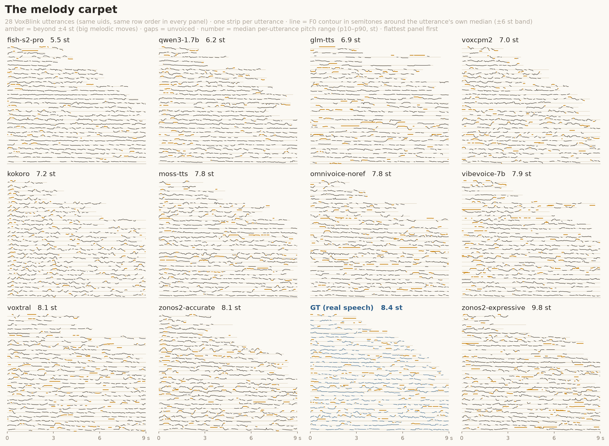

# Register-normalized pitch range

`scripts/pitch_range_dist.py` (distribution), `scripts/paired_itw.py` (per-utterance,
In-The-Wild only) and `utils/pitch_range.py` (the F0 logic). Outputs:
`results/pitch_range_<set>_<lang>.csv` and `results/paired_itw_<lang>.csv`.

This is the pitch readout of ZTTS2-Eval. It asks how much a system's melody *moves*
compared with real speech, and nothing about whether its voice is high or low: a mean-F0
score is dominated by the speaker's register, so it mostly re-measures speaker
similarity, and it cannot tell a flat delivery from a lively one.

## Method

1. Load the wav at 16 kHz and trim lead/trail silence (`librosa.effects.trim`,
   `top_db=35`, as for char/s and rhythm). Audio shorter than 0.5 s (8,000 samples)
   after trimming is not scored.
2. F0 track: `librosa.pyin`, 60–400 Hz, `frame_length=1024`, `hop_length=320` (20 ms).
   A width-3 median filter over the voiced frames removes single-frame octave blips.
3. Semitones around the utterance's **own** voiced median: `12·log2(f0 / median)`.
   An utterance with fewer than 10 voiced frames is unusable. This is what removes the
   register: a low and a high voice with the same intonation give the same values.
4. Per-utterance **pitch range** = p90 − p10 of those semitone deviations.
5. Per (set, language) the metric is the 2-Wasserstein distance between a system's
   distribution of per-utterance ranges and the reference's. The reference is the
   **prompt recordings** of the same uids (`data/<set>/<lang>/prompt_wav.scp`).

The CSV has one row per system: `n`, `median_st` (median range in semitones),
`median_ratio` (system median / reference median; below 1 = flatter than real speech —
the direction that `d_ref` alone cannot show), `d_ref` (the W2 distance), `x_ceiling` and
`benchmark_version`. Rows are sorted by `d_ref`, lower is better.

## The split-half ceiling

Two halves of the *same* real speech are not at distance 0 at finite n. `x_ceiling` is
`d_ref` divided by that finite-sample **ceiling**: the mean W2 over 32 random disjoint
n/2-vs-n/2 splits of the reference (`speaking_rate_dist.ceiling`). A system is compared
at the same half-vs-half geometry (`speaking_rate_dist.w2_fair`: mean over 32 n/2
subsamples of both sides), because comparing full samples against a split-half ceiling
flatters every system — the W2 noise floor shrinks with n (see
[rhythm.md](rhythm.md)). So `x_ceiling = 1` reads "as close to real speech as two
halves of real speech are to each other", and the ceiling row
`__CEILING_split_half__` (rank 0) of every CSV pins that line. The Clean ground truth
is the prompt audio itself, so it is not scored against itself; the ceiling row stands
for it.

## The 500-uid sample

pYIN is too slow to run on every utterance of every system, so the pitch-range metrics
use a fixed sample: `utils.benchmark.sample_uids(task, lang, n=500, seed=0)` — a seeded
`random.Random(0).sample` of the sorted uids of `data/<task>/<lang>/text`, returned
sorted. It depends only on the data, so every system, the reference and the paired
metric below see the same items. Languages with fewer than 500 items use all of
them (the smallest ITW language, vi, has 108).

`--min-utts` (default 100, capped at 80 % of the sample) is the minimum number of
usable utterances for a system to be scored, so small languages such as vi, uk, th and
nl are scored rather than skipped. Per-utterance ranges are cached as
`uid<TAB>range` TSVs (empty = unusable wav): `<leaf>/pitch_range.tsv` per system,
`results/_pitch_range_ref/<set>_<lang>.tsv` for the reference. Only missing uids are
computed.

```bash
python scripts/pitch_range_dist.py --test-set zero_shot_voxblink --lang en
python scripts/pitch_range_dist.py --test-set zero_shot --lang de --models omni_voxcpm2
```

In the results report the headline column is `x_ceiling` (**Pitch range ×ceil**); the
tradeoff figure plots its macro average over the language basket against WER.

## Paired prosody on the In-The-Wild set

Every ITW item has a real recording of the same speaker saying the *target* sentence
(`data/zero_shot_voxblink/<lang>/target_wav.scp`). The distribution metrics above
cannot use it, because W2 ignores which utterance is which. `paired_itw.py` compares
each generation with its real recording, utterance by utterance, on the same 500-uid
sample:

| per-utterance quantity | definition |
|---|---|
| `dur_log2` | log2(trimmed duration of the generation / of the real recording), over the generations the ASR heard with WER ≤ 20% (`n_dur` of them; empty below 50) |
| `pause_diff` | #pauses(generation) − #pauses(real); a pause is a gap ≥ 0.2 s between two Silero VAD speech segments (an energy rule misses most pauses under the background noise of real in-the-wild recordings; [controls C8](controls_2026-08.md)) |
| `range_log2` | log2(pitch range of the generation / of the real recording) |

Per system the CSV reports `dur_log2_med`, `pause_diff_mean`, `range_log2_med` (signed:
the bias — positive = longer, more pauses, wider pitch range than the real recording) and the absolute
versions `dur_abs_med`, `pause_abs_mean`, `range_abs_med` (how far off a typical
utterance is). The report shows the absolute ones (**Dur |log2|**, **Pause Δ**,
**Pitch-range |log2|**); 0 = the generation matches the real recording.
The real-recording ground truth (`gt_zero_shot_voxblink`) is not a row: it *is* the
reference.

`paired_itw.py` reads the same `<leaf>/pitch_range.tsv` caches as
`pitch_range_dist.py` and caches the real recordings' ranges in
`results/_pitch_range_ref/zero_shot_voxblink_<lang>_target.tsv`, so run the two in one
job, in that order (the `pitch_range` jobs of `slurm/submit_metrics.sh` do):

```bash
python scripts/paired_itw.py --lang en
```

## Limits

- It measures spread, not shape. Two utterances with the same p90 − p10 but opposite
  contours are equal; the carpet view below is the check for shape.
- pYIN fails on whispery, creaky or very noisy audio; those utterances drop out
  (`n` in the CSV shows how many survived).
- The unpaired metric matches distributions of *different* utterances (the references
  are prompts, not the targets); only the paired metrics are utterance-aligned.
- A 500-item sample makes per-language values noisier than a metric computed on every
  utterance; read cross-language averages rather than single languages.

## The melody carpet — the contour view



`scripts/plot_pitch_carpet.py` — the pitch sibling of the rhythm pause carpet
(`docs/rhythm.md`), showing the contour that a single number per utterance compresses.
One panel per system, the same VoxBlink uids as the rhythm carpet (seed 0), each strip
the utterance's pYIN F0 track from `utils/pitch_range.py` in semitones around its own
voiced median (register removed, melody kept; ±6 st band, width-3 median filter kills
octave blips, unvoiced gaps show the pale thread). Amber ink where the contour leaves
±4 st — big melodic moves, the thing flatteners can't do. Panels print and sort by the
median per-utterance p10–p90 range in semitones — the same quantity as `median_st` —
flattest first.

Reading (VoxBlink/en, the carpet's 70-uid sample): fish-s2-pro compresses melody
hardest (5.5 st vs GT 8.4) with qwen3-1.7b next (6.2) — the same RL/ASR-flattening
fingerprint the rhythm views show — while zonos2-expressive overshoots real speech
(9.8). **kokoro's contour is normal (7.2)** even though its preset voice does not match
the prompt speaker's register: the per-utterance median normalization is what separates
"wrong voice" from "monotone delivery".

Practical notes: F0 tracks are npz-cached per system under
`results/pitch_perutt_<set>_<lang>/` (first pass ~25–50 min CPU at 48 workers, no GPU;
re-renders are seconds). `--n-show 28` draws an evenly-spaced subset of the 70 cached
uids — 70 strips squeezed the contours into ~7 px dashes and every panel looked
identical (same lesson as the rhythm ridgeline's <50 ms cut). `--row-order duration`
gives the per-panel staircase variant.
