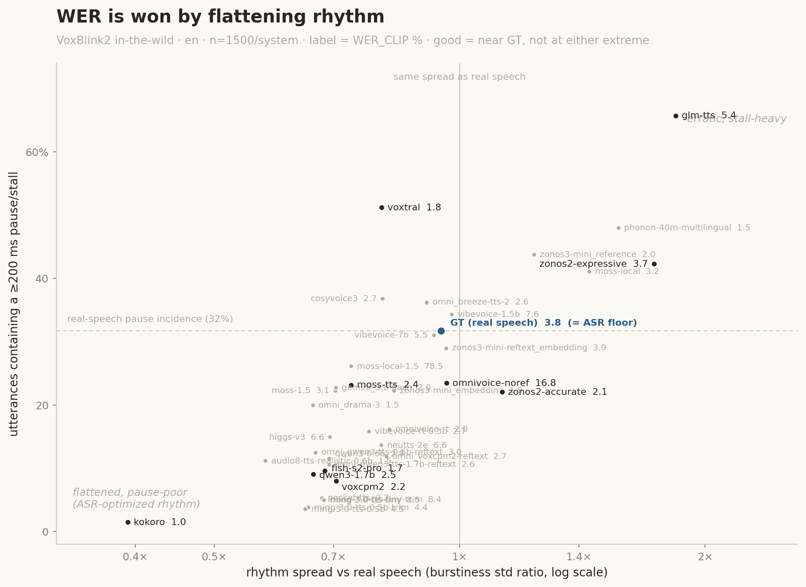
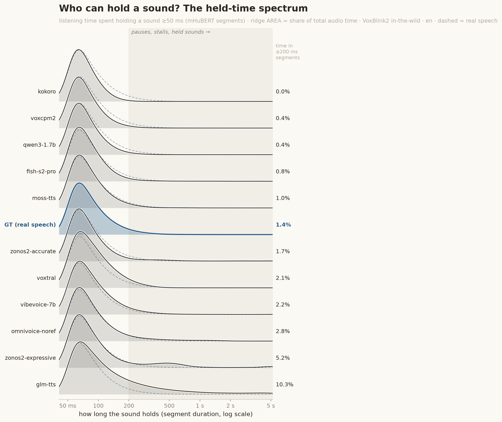
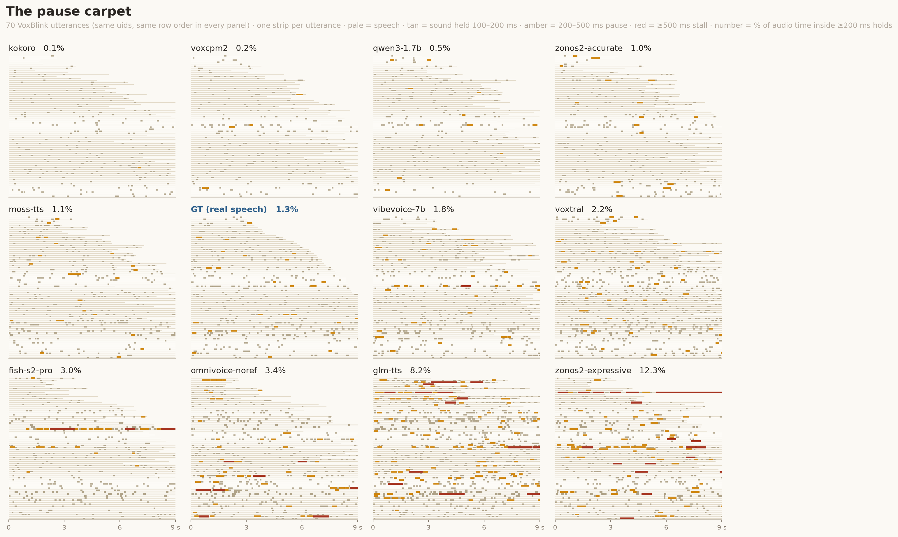
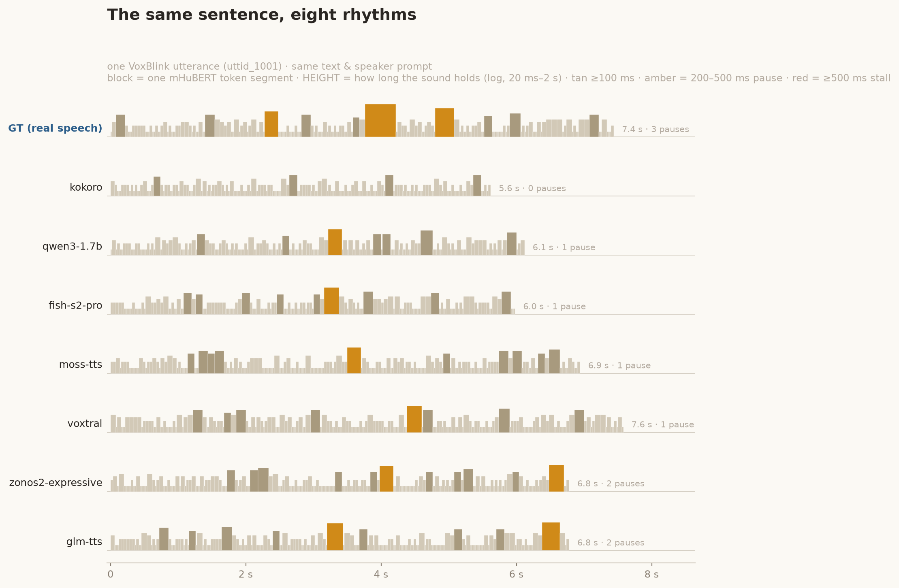

# Rhythm metrics over deduped mHuBERT-147 k-means tokens

`scripts/prosody/rhythm_dist.py` — a distributional rhythm/timing readout, validated by
`scripts/analysis/validate_rhythm_metric.py`. Output: `results/rhythm_<set>_<lang>.csv`.

## Method

1. Cut each file to its speech span: first to last Silero VAD speech segment
   (`utils/vad.py`, pinned v6.2.3, 30 ms pad). Internal pauses are kept — they
   are rhythm. Until 2026-11 this was the 35 dB energy trim shared with char/s,
   which kept any edge sound within 35 dB of the peak: noise floors, and the
   tones, hums and bursts some systems generate before speaking, all scored as
   stalls ([controls C9](controls_2026-08.md)).
2. mHuBERT-147 (multilingual, 147 langs) layer-9 features, 20 ms frames.
3. k-means (k=100 default) fitted on frames from the **reference set** and
   cached to `~/.cache/ztts2_eval/rhythm` (same anchor pattern as the MPM
   shuffle floor: every system in one (set, lang) scores against the same
   centroids). The HF repo ships no clustering, so we fit our own; token IDs
   differ per language, which is irrelevant for within-language comparison.
4. Collapse consecutive duplicate tokens (**dedup**); the run lengths of the
   surviving segments carry the timing signal.
5. Four per-utterance dimensions, reported **separately** (Prosody-Profile
   philosophy — no combined mean):

   | dim | definition | reads as |
   |---|---|---|
   | `rate` | deduped tokens / s | segment (≈phone) rate; text-free complement to char/s |
   | `burstiness` | (σ−μ)/(σ+μ) of run lengths | −1 metronome, 0 Poisson, →1 stall-dominated |
   | `npvi` | pairwise variability index of run durations | stress- vs syllable-timing contrast |
   | `long_frac` | frames in runs ≥ 200 ms / all frames | pause / stall / drawl mass |

6. Per dim: `d_ref` = 2-Wasserstein between the system's per-utterance values
   and the reference's (identical `w2` to `speaking_rate_dist.py`), computed at
   the ceiling's **half-vs-half geometry** (mean over 32 n/2-vs-n/2 subsamples)
   and reported against the reference split-half **ceiling**
   (`x_ceiling` = d_ref / ceiling). Full-vs-full W2 has a lower noise floor
   than a split-half ceiling and flattered every system (fish-s2-pro: 0.86×
   full-vs-full → 1.14× matched). `speaking_rate_dist.py` (char/s) and
   `pitch_range_dist.py` score with the same `w2_fair`, so all three
   distributional prosody metrics share one geometry. `--min-utts` defaults to
   100 here and in the other two, so the small ITW languages (vi, uk, th, nl)
   are scored rather than skipped.
7. d_ref is direction-blind, so two directional columns ride along:
   `{dim}_std_ratio` (system std / ref std; < 1 = over-regularized) and
   `long_pct` (% of utterances with any ≥200 ms run — pause incidence).

Two of the four dimensions are the headline in the results report
(`RESULTS_CURRENT.md`, tradeoff figures, explorer): the **pause/stall factor**
(`burstiness_x_ceiling` in the CSV) and the **pace factor** (`rate_x_ceiling`),
both as multiples of the real-speech split-half ceiling. Rows carry a
`benchmark_version` column, and only the uids of the current `text` are scored.
Contour is covered by [pitch_range.md](pitch_range.md).

## Validation (constructed ground truth, clean/en, 300v300 split)

Per the metric-validation post-mortems (FPD), rankings-vs-listeners across ~12
systems have no power; the metric is instead validated on perturbations with a
known answer. Cells = W2 d_ref as a multiple of the untouched-half null
(`results/rhythm_validation_clean_en_k100.csv`):

| probe | rate | burstiness | npvi | long_frac | verdict |
|---|--:|--:|--:|--:|---|
| null | 1.0× | 1.0× | 1.0× | 1.0× | baseline |
| tempo ±25 % (WSOLA) | **12.2–14.4×** | 6.9–8.8× | 10.4–12.9× | 2.1–5.2× | detected, monotone medians (30.5 → 34.0 / 26.5) |
| 2 × 300 ms pauses | 4.1× | **6.2×** | 3.5× | **5.8×** | detected on the targeted dims |
| white noise @ 20 dB SNR | 1.7× | 1.2× | 2.7× | 0.5× | **near the null** — not a quality metric in disguise (see below) |
| time reversal | 6.8× | 0.9× | 4.3× | 0.9× | detected (see below) |
| 1 s lead+trail digital silence | 1.0× | 1.0× | 1.4× | 1.3× | **padding-immune** (the Allosaurus-SR footgun) |
| 1 s lead+trail hiss (−45 dB rel RMS) | 1.1× | 1.0× | 1.2× | 1.4× | **padding-immune** even for the realistic vocoder-floor case |
| 1 s lead+trail noise (−20 dB rel RMS) | 1.2× | 1.3× | 1.8× | 0.5× | **immune to audible noise edges** (5.9–13.6× under the old 35 dB trim) |
| 1 s 200 Hz hum before the speech | 1.0× | 1.0× | 1.4× | 1.0× | **immune to generated lead-in tones** (up to 47× under the old trim) |

- **The noise row is the key control.** TTSDS's Hubert-token speaking rate
  reproduced ~40 % of a tempo response with constant-rate white noise; this
  metric stays near the null under noise. The row varies from split to split:
  over seeds 0–2 it reads 1.1–1.7× (rate) and 1.3–2.7× (npvi), and the earlier
  35 dB-trim version read 0.9–2.4× and 1.1–1.8× — an order of magnitude below
  the tempo response either way.
- **The edge rows close the Allosaurus-SR footgun** (its "speaking rate"
  ranked lead/trail silence, ρ +0.6 with padding). Every wav — reference,
  system, probe — is cut to its Silero speech span in `load_dir` before
  tokenization, and the probes verify the cut works: pad-then-cut is a no-op for
  digital silence, −45 dB hiss, audible −20 dB noise and a steady hum. The old
  35 dB energy trim passed the first two but kept the last two, scoring them as
  stalls ([controls C9](controls_2026-08.md)). Internal pauses are untouched by
  design — they are the `burstiness`/`long_frac` signal.
- **Reversal is detected**, unlike a mean-F0 pitch score (the retired mean-F0
  metric scored backwards GT at 97.2). Reversed transients re-segment the token stream. Strictly this means
  the dims are not *pure* timing — they also see segmentation stability — but
  moving on reversed speech is the desirable direction.
- Selectivity is partial: a tempo change moves all four dims (npvi/burstiness
  through 20 ms quantization, not just true rate). Read the four dims jointly,
  not as independent axes.

## The one-picture summary

`scripts/plots/plot_rhythm_scatter.py` — burstiness std_ratio (log x, 1.0 = same
spread as real speech) against pause incidence. GT anchors the middle; the
ASR-optimized cluster is lower-left (kokoro at the extreme, 0.38× / 1.8 %),
erratic systems upper-right (glm-tts 2.16× / 67.5 %). Good = near GT, not at
either extreme. Each label carries that system's en WER_CLIP as printed data
(Tufte: the number, not a bubble size or color ramp) — the flattened shelf
visibly holds the small WERs (1.6–2.8), the erratic corner the blow-ups.

## The intuition views: held-time spectrum + barcode

`scripts/plots/plot_rhythm_ridgeline.py` — the rhythm analogue of a pitch
ridgeline. Each ridge is the distribution of *listening time* over mHuBERT
segment duration (log x), ≥50 ms only, normalized by total audio time — so
ridge AREA = the share of a system's audio spent holding a sound, and the
right margin prints the ≥200 ms share (rows sorted by it). Reads as the
adjectives: kokoro flatlines at 200 ms (0.0 % — monotonous), GT's blue
shoulder crosses into the pause zone (1.4 %), zonos2-expressive grows a stall
bump at ~500 ms (5.2 %), glm-tts is a mountain (10.3 %). Flatteners show the
dashed GT ghost poking out above their curve (missing held time); stallers
exceed it. Needs `runlen_hist` in the `--dump-dir` npz (rhythm_dist.py dumps
it since 2026-08-23).

Design lessons baked in: (1) TIME-weight the run lengths — raw counts are
dominated by 1-2-frame segments and every system looks identical; (2) start
the x-axis at 50 ms — below that sits the universal 20-40 ms phone body,
which carries no between-system signal and visually drowns the tail.

`scripts/plots/plot_rhythm_carpet.py` — the middle ground between the two: small
multiples, one panel per system, the SAME 70 utterances (same uids, same
row order) as thread-and-knot strips — speech is a thin pale thread,
100–200 ms holds thicken it (tan), 200–500 ms clause pauses are AMBER knots,
and ≥500 ms stalls are RED, thicker knots (height tiers ported from the
barcode's skyline so they protrude even at ~6 px strip heights). Pause vs
stall get different ink on purpose — natural clause pausing and pathological
stalling are different phenomena — and the severity ramp (amber warning →
red alarm) makes the alarm color exclusive to pathology: GT's panel contains
ZERO red, glm/expressive/omnivoice are red-streaked. `--scheme redmaroon`
keeps the earlier escalating-reds variant
(`*_byduration_redmaroon.png` retained for comparison). Population-scale but read as texture: kokoro is
unmarked cloth, GT (blue, center of the grid) is lightly peppered,
zonos2-expressive/glm-tts are streaked. Panels are sorted by the pause-time
share computed on the sampled utterances so the printed number and grid
position always agree; that sampled share is noisier than the full-set
histogram (fish-s2-pro reads 3.0 % here vs 0.8 % full-set because one
runaway generation — visible as a solid red streak in its panel — dominates
the sample, which is itself informative). Needs a GPU (~12×70 wavs).
`--row-order` picks the row layout: `matched` (same uid at the same height
in every panel — rows comparable across panels, ragged envelope) or
`duration` (each panel sorted by its own strip durations → clean staircase,
`*_byduration.png`). The duration sort adds a readable second axis — where
in the length distribution the pathology lives: omnivoice-noref/glm-tts
concentrate red in their shortest strips (stalled truncations), and fish's
single runaway sits at the very bottom as its longest strip.

`scripts/plots/plot_rhythm_barcode.py` — the honest anecdote: the SAME VoxBlink
utterance (same text, same prompt; GT = the real recording) as one rhythm
SKYLINE per system — each token segment is a block whose HEIGHT is how long
the sound holds (log, 20 ms–2 s), tan ≥100 ms, amber = 200–500 ms pause,
red = ≥500 ms stall (same `--scheme` flag as the carpet). Real speech is
irregular rubble with amber towers; kokoro is uniform low-rise with none. (The default exemplar uid happens to contain
no ≥500 ms stall in any system — the uid rule optimizes GT pauses, not
narrative; the carpet is where the stall ink shows.)
(The flat equal-height version read as noise; height is what made it
legible, and the carpet inherited the idea as thread/knot thickness.) The uid is picked deterministically (5-9 s GT with the most
≥200 ms segments among shared uids). Tokenizes ~8 wavs on the fly against the
cached k-means anchor, so it needs a GPU.

## What the dims measure on real systems (clean/en, 22 systems)

Descriptive only — n=22 system-level rank correlations carry CIs of roughly
±0.4, so none of this is a validated claim (that is what the perturbation
matrix above is for):

- Not WER in disguise: Spearman vs zero-shot en WER_CLIP is +0.19 (rate) to
  +0.41 (burstiness, long_frac).
- The four dims behave as ~two factors at system level: pace/variability
  (rate↔npvi ρ=+0.90) and stall/pause mass (burstiness↔long_frac ρ=+0.91).
- **std_ratio + long_pct split the field into the two failure modes d_ref
  conflates.** Over-regularizers (std_ratio < 1, pause-poor — the RL/ASR-
  optimized signature): qwen3-0.6b/1.7b pause in 2.7/3.8 % of utts vs GT's
  8.7 % with spread 0.73–0.79×, voxcpm2 pauses in 1.9 %, kokoro compresses
  rate spread to 0.54×; fish-s2-pro is the mildest member (x_ceiling
  1.0–1.6×, std 0.78–0.95, pauses 5.2 %). Erratic/stall-prone (std_ratio > 1,
  long_pct 20–28 %): omnivoice, zonos2-expressive, glm-tts, voxtral. The
  zero-shot WER leaders all sit in the first cluster — consistent with
  rhythm-flattening being part of how they win WER.
- **The fish-s2-pro case study (over-regularization is real but subtle).**
  fish's prosody is RL-tuned for WER, and the first (full-vs-full) scoring read
  it at/below ceiling — implausible, and it prompted the geometry fix. At
  matched geometry fish is above ceiling (1.14×/1.17×/0.87×/1.72×), its spread
  is narrower than real speech on every dim (std ratios 0.95/0.91/0.97/0.78),
  and it produces ~45 % less pause mass (long runs in 5.2 % of utts vs GT's
  8.7 %; mean long_frac 0.0014 vs 0.0025) — the ASR-legibility signature, and
  why long_frac was always its worst dim. What it does NOT do is emit a fixed
  house rhythm: in the matched per-uid test below it tracks content best of
  the systems probed.
- **Matched per-utterance test (VoxBlink/en, real recording of the same uid).**
  Per-utt dims dumped with `--dump-dir`; Spearman of system vs GT recording per
  uid, n=1500. Content-tracking sanity: kokoro (preset voice, no cloning) sits
  at ρ≈0.02–0.09 and matched/shuffled |Δ| ≈ 0.97 — the expected null. fish and
  qwen3-1.7b track best (rate ρ≈0.39/0.42, matched/shuffled ≈0.74/0.77);
  zonos2-accurate is weaker (ρ≈0.25). W2 alone is blind to this axis.
- **Real-speech null on VoxBlink/en** (`results/rhythm_in-the-wild_en.csv`):
  the GT baseline there holds *real target recordings* (a different sample from
  the prompts, unlike FLEURS where GT wavs are the prompts and get skipped) and
  scores 1.2–1.5× at matched geometry with std_ratio ≈ 0.93–1.01 — at the
  noise floor, below every synthetic system (best TTS: 2.7× burstiness). Real
  speech passes; all 24 TTS systems are separable from it.
- **In-the-wild refs expose over-regularization far harder than FLEURS.**
  Real VoxBlink speech pauses in 31 % of utterances; fish 12 %, qwen3-1.7b
  10 %, voxcpm2 9 %, kokoro 2 %. FLEURS-R is professionally read (GT long_pct
  8.7 %), so read-speech references partially mask the rhythm-flattening —
  fish's near-ceiling clean showing was set-flattery as much as geometry
  flattery.

## Gotchas (hard-won, do not rediscover)

- **Do not use `librosa.effects.time_stretch` as a tempo probe.** It is a
  phase vocoder; transient smearing merges token boundaries and a 25 % SPEED-UP
  *lowers* measured segment rate (30.0 → 27.9). ffmpeg `atempo` (WSOLA) and
  naive resampling both give the correct monotone response. This wasted a full
  validation round.
- **Frame-rate saturation.** Median run length is ~1.7 frames at k=100; the
  token stream sits near the 50 Hz ceiling, so rate responses to tempo are
  compressed (±25 % tempo → ∓12–13 % measured). Monotone and detectable, but
  not proportional.
- **k=100 beats k=500** on every probe (k=500: tempo speed-up only 1.6× null,
  pause probe barely visible; `results/rhythm_validation_clean_en_k500.csv`,
  measured with the broken phase-vocoder probes but the gap is large).
  More clusters = more spurious boundaries = shorter, noisier runs.
- **`long_frac` threshold must sit below the physical pause length**: a 300 ms
  inserted silence survives tokenization as only ~220 ms of stable frames
  (boundary conv effects), so the 300 ms default silently missed its own probe;
  default is now 200 ms.
- `long_frac` is a sparse tail dim (median 0 on FLEURS-R read speech) — the
  medians say nothing; only d_ref does.
- mode/median filtering of labels before dedup lengthens runs toward phone-like
  rates (~15 seg/s at width 5) but does **not** change tempo-response behavior;
  raw labels validate fine and are kept.
