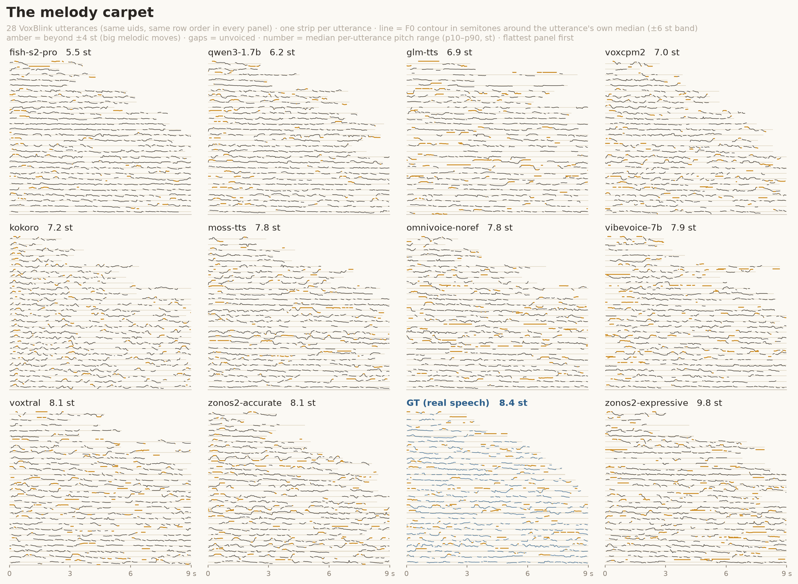

# TTSDS2 Pitch integration

ZTTS2-Eval retains one TTSDS2 readout: **Pitch**, the distribution of per-file
mean F0. It is easy to inspect in Hz and complements the two primary
distributional prosody metrics:

- **Speaking rate:** 2-Wasserstein distance between generated and reference
  characters-per-second distributions (`scripts/speaking_rate_dist.py`).
- **MPM span:** Masked Prosody Model distance normalized per language between
  the real-speech split-half floor (0) and a contour-scrambled floor (1)
  (`utils/score_mpm_shuffle_floor.py`). Computed on FLEURS-R only — its anchors
  collapse on in-the-wild audio, and it carries a known loudness confound. See
  [`mpm_itw_limits.md`](mpm_itw_limits.md).
- **TTSDS2 Pitch:** mean-F0 distribution similarity on a 0–100 scale, where
  higher is closer to the real-speech reference (`utils/score_ttsds_pitch.py`).

The old TTSDS2 composite, TTSDS MPM score, Allosaurus speaking rate, and HuBERT
token speaking rate are intentionally not reported. Characters per second is a
more direct rate measure, while MPM span has meaningful real/scrambled anchors.
Pitch remains because its underlying values are interpretable, but it should be
read with speaker similarity: mean F0 is speaker-dependent, so the two metrics
can be correlated.

## Pitch score

TTSDS extracts one mean-F0 value per utterance and compares the synthetic and
reference distributions with 1-D Wasserstein distance. It normalizes that
reference distance against the closest built-in noise distribution:

    score = d_noise / (d_noise + d_ref) * 100

A higher score means the generated mean-F0 distribution is closer to the
reference. This normalization is nonlinear and its noise anchor depends on the
reference set; use the raw ridgeline distributions for interpretation rather
than treating score differences as interval-scaled.

## Ground-truth 50/50 baseline

The explorer's ground-truth row is not scored against the same files. For each
test-set/language pair, seed 0 reproducibly shuffles the reference wavs and
partitions every file into disjoint halves (one half has one extra file for an
odd corpus size). Characters/s distance, Pitch, and MPM span then score the
first half against the second. Run or refresh every language with:

```bash
bash slurm/submit_ground_truth_metrics.sh
```

Pitch is written to `results/gt_<test_set>/<lang>/ttsds_pitch.csv`; MPM rows are
written under `results/_mpm_ground_truth/`. The characters/s halves are carried
directly in the published explorer payload.

## Run

Create the dedicated environment once:

```bash
bash scripts/setup_ttsds_env.sh
```

Score one test-set/language pair or all configured pairs:

```bash
bash scripts/run_ttsds_pitch.sh zero_shot en
bash scripts/run_ttsds_pitch_all_langs.sh
```

Each system writes:

```text
results/<model>/<test_set>/<lang>/ttsds_pitch.csv
```

The runner skips a non-empty output. Remove that file to rescore it.

## Inspect the distributions

TTSDS caches each utterance's mean F0 under
`~/.cache/ttsds/benchmarks/Pitch/`. Build or refresh the frozen plot input from
that cache, then render the ridgeline:

```bash
~/.venvs/ttsds/bin/python scripts/plot_ttsds_pitch_ridgeline.py --refresh
python scripts/plot_ttsds_pitch_ridgeline.py
```

Outputs:

```text
assets/plots/ttsds_pitch_ridgeline_data.npz
assets/plots/ttsds_pitch_ridgeline.png
```

## Reference-distribution safeguard

TTSDS2 2.1.1 wires HuBERT clustering datasets even when only Pitch is enabled.
Its `Dataset.sample()` mutates the dataset in place; without a workaround this
shrinks the shared reference to 100 utterances. `score_ttsds_pitch.py` supplies
separate throwaway clustering datasets so Pitch always uses the full reference
corpus.

## The melody carpet — the contour view Pitch cannot give



`scripts/plot_pitch_carpet.py` — the pitch sibling of the rhythm pause carpet
(`docs/rhythm.md`), showing exactly what mean-F0 Pitch is blind to: the
contour. One panel per system, the same VoxBlink uids as the rhythm carpet
(seed 0), each strip the utterance's pyin F0 track in semitones around its
own voiced median (register removed, melody kept; ±6 st band, width-3 median
filter kills octave blips, unvoiced gaps show the pale thread). Amber ink
where the contour leaves ±4 st — big melodic moves, the thing flatteners
can't do. Panels print and sort by the median per-utterance p10–p90 range in
semitones, flattest first.

Reading (VoxBlink/en): fish-s2-pro compresses melody hardest (5.5 st vs GT
8.4) with qwen3-1.7b next (6.2) — the same RL/ASR-flattening fingerprint the
rhythm views show — while zonos2-expressive overshoots real speech (9.8).
**kokoro's contour is normal (7.2)**: its terrible TTSDS Pitch scores are
pure register mismatch (preset voice ≠ prompt speaker), not monotone
delivery — the per-utterance median normalization is what separates those
two stories.

Practical notes: F0 tracks are npz-cached per system under
`results/pitch_perutt_<set>_<lang>/` (first pass ~25 min CPU at 48 workers,
no GPU; re-renders are seconds). `--n-show 28` draws an evenly-spaced subset
of the 70 cached uids — 70 strips squeezed the contours into ~7 px dashes
and every panel looked identical (same lesson as the ridgeline's <50 ms
cut). `--row-order duration` gives the per-panel staircase variant.
